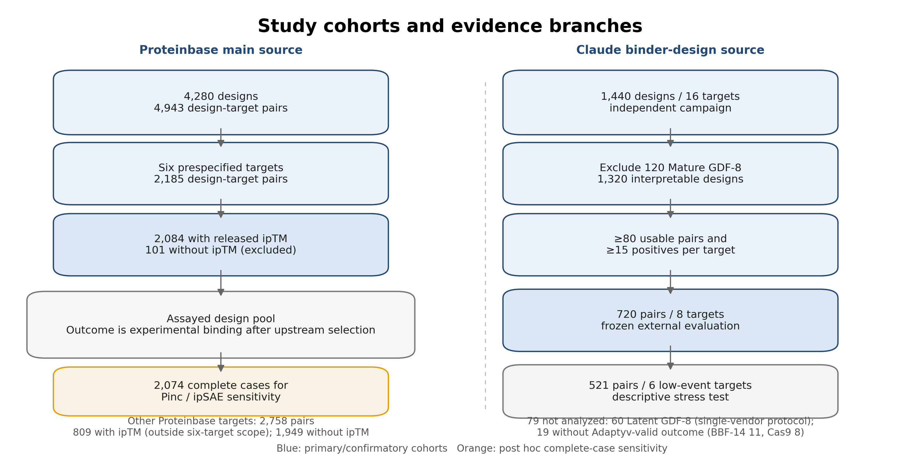
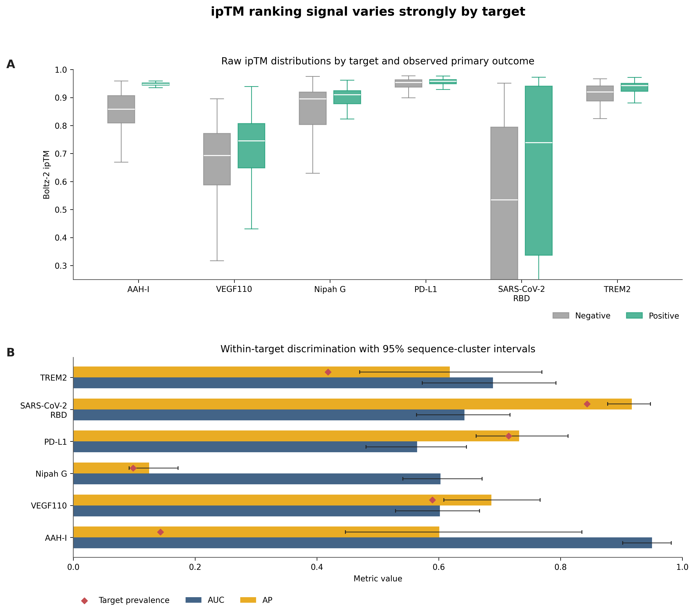
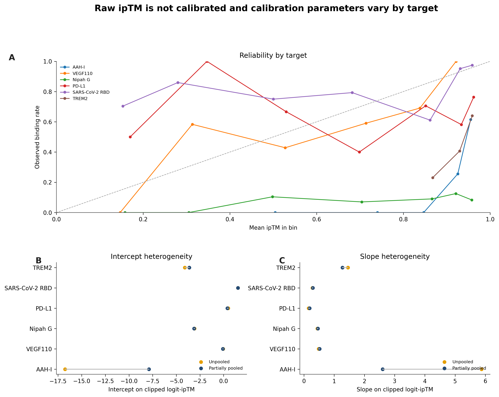
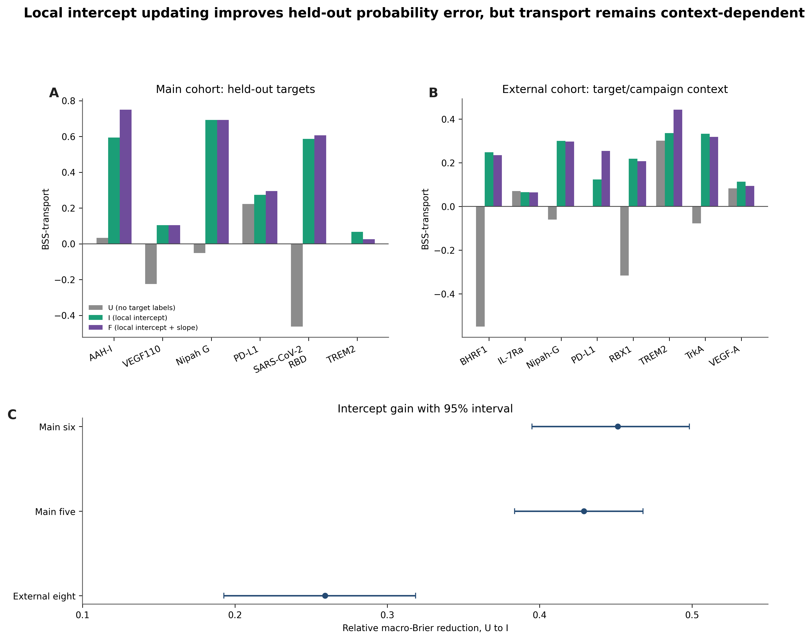
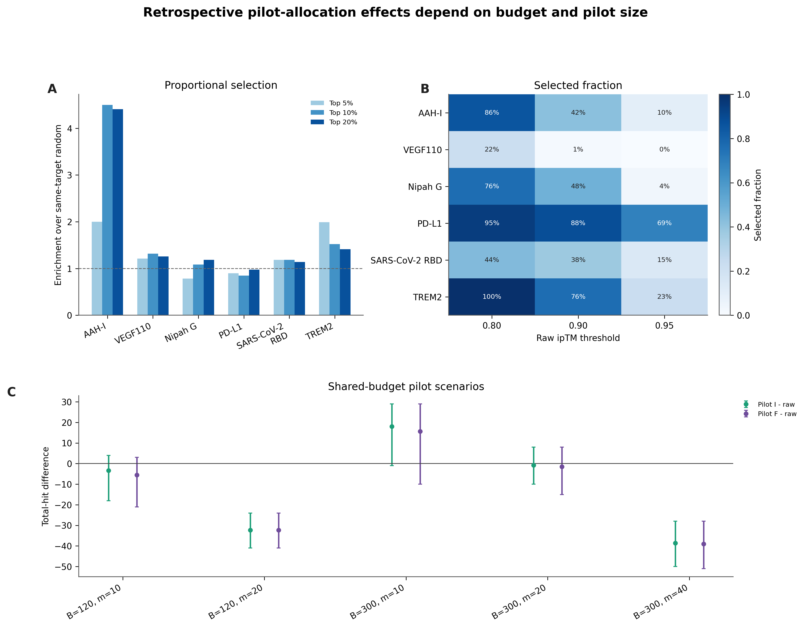
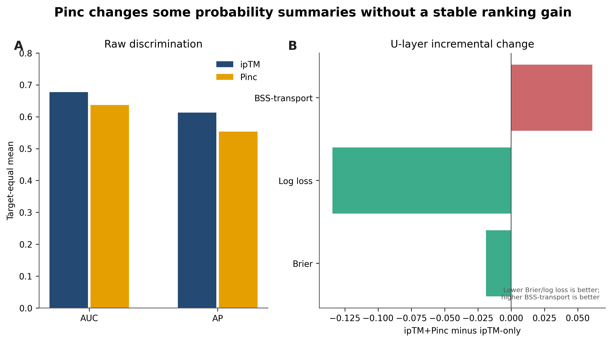
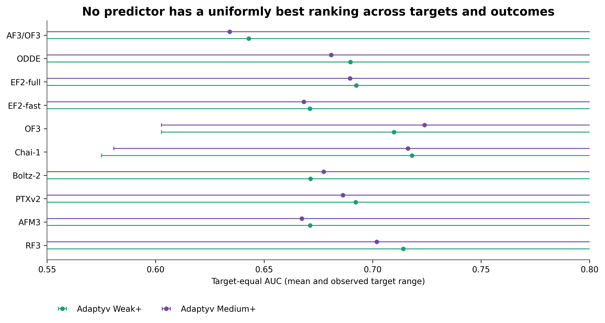

# Context-dependent calibration and experimental decision value of Boltz-2 ipTM in binder design

**Article type:** Original Article  
**Draft status:** Submission candidate prepared for Protein Science. The `v1.1.0` local release candidate contains the post-review analyses and amended evidence boundaries. Author metadata and declarations are complete; the public tag and activation of the reserved archival DOI remain pending mainline release approval.  
**Authors:** KangMing Chen (1) ([ORCID 0009-0006-9634-5397](https://orcid.org/0009-0006-9634-5397))  
**Affiliations:** (1) College of Biological Science and Medical Engineering, Donghua University, Shanghai, China (ROR: https://ror.org/035psfh38)  
**Corresponding author:** KangMing Chen, LeoChen070809@outlook.com

## Abstract

Computational binder-design scores are used to rank candidates, estimate experimental success, and allocate assays, but these uses require different evidence. We evaluated Boltz-2 interface predicted TM-score (ipTM) in 2,084 experimentally assayed design–target pairs from six targets, including 748 binding-positive outcomes, and in 720 external pairs from eight targets. Target-equal AUC was 0.675, decreasing to 0.620 without AAH-I, but raw ipTM was not an experimental-binding probability (Brier 0.416). Mappings learned from other targets had a transport-reference Brier skill score of -0.0809 (95% interval -0.1133 to -0.0491), positive in only two of six targets. A post hoc intercept update reduced target-equal Brier by 45.1% (39.5% to 49.8%) in six targets and 42.9% (38.4% to 46.8%) after complete refitting without AAH-I, whereas additional slope updating was inconsistent. The frozen external mapping remained context-dependent. In the evaluated out-of-fold analyses, local intercept updating reduced observed probability error by 25.9% in Brier (19.3% to 31.9%), with bootstrap-interval support, but did not establish a universal calibration mapping. Common raw-score thresholds produced different selected-set sizes; post hoc exploratory retrospective shared-budget simulations of pilot-based allocation showed mixed net effects that depended on budget and pilot size, rather than prospective assay savings. In these contexts, ipTM was a target-local ranking aid, not a portable success probability or a common cross-target probability threshold; absolute-probability and allocation claims require representative local measurements and cost-aware evaluation.

**Keywords:** binder design; Boltz-2; ipTM; probability calibration; external validation; experimental allocation

## Introduction

De novo protein design has expanded from creating new folds to designing functional proteins, including binders, enzymes, and ordered assemblies, with applications in therapeutics, diagnostics, and biotechnology (Huang et al., 2016; Yang et al., 2026). For target-binding design, the practical problem begins before structure generation: a target surface must be chosen, candidate backbones and sequences must be generated, and a small subset of designs must then be selected for expression and assay. Computational scores enter each of these decisions, but ranking, absolute success probability, and the value of an assay allocation are not interchangeable.

Target-conditioned binder design now combines backbone generation, sequence design, structure prediction, and experimental validation. Cao et al. (2020, 2022) extended miniprotein design from a single viral target to diverse targets, ProteinMPNN enabled efficient sequence design on fixed backbones (Dauparas et al., 2022), and RFdiffusion generated and experimentally characterized designed binders (Watson et al., 2023). Integrated filters have further increased reported success: AlphaFold2- and RoseTTAFold-based checks improved one binder-design workflow nearly tenfold (Bennett et al., 2023), AlphaProteo reported higher affinity and success on seven targets (Zambaldi et al., 2024), and BindCraft reported one-shot design across diverse targets (Pacesa et al., 2025). Success rates still depend on workflow, target, assay, and denominator (Li et al., 2026), while protein production and characterization remain a finite resource (Qian et al., 2026).

Structure prediction supplies the coordinates and confidence outputs used for these filters. AlphaFold2 and RoseTTAFold established accurate protein and complex prediction (Jumper et al., 2021; Baek et al., 2021), ESMFold accelerated sequence-to-structure inference (Lin et al., 2023), and AlphaFold 3 generalized prediction across biomolecular components (Abramson et al., 2024). Interface predicted TM-score (ipTM), predicted TM-score (pTM), predicted local distance difference test (pLDDT), and predicted aligned error (PAE) describe different aspects of structural or interface confidence, and Boltz-2 adds binding-affinity-related outputs (Passaro et al., 2025). A predicted complex does not by itself establish experimental binding, and these confidence values are not probabilities of assay success. ipTM is sensitive to full-chain context (Dunbrack, 2025); interface-focused alternatives such as interaction prediction score from aligned errors (ipSAE) and probability of interface native contacts (Pinc) summarize PAE over interacting regions, and Pinc can be calibrated against native structural contacts in benchmarks (Dunbrack, 2025; Badonyi and Toth-Petroczy, 2026).

Empirical work has begun to separate these objectives. Across 3,766 experimentally tested binders from 15 targets, Overath et al. (2025) found that interface-focused scores, especially AlphaFold 3-derived ipSAE, improved target-agnostic ranking and filtering over ipTM and related features. Their analysis supports shortlisting, but it does not show that a probability mapping fitted elsewhere will be calibrated on a new target without labels. In monomer design, AlphaFold, ESMFold, and ProteinMPNN confidence metrics discriminated successful from unsuccessful designs only moderately, and their behavior depended on topology (Garcia et al., 2026). In a separate antibody-antigen benchmark, internal confidence metrics often failed to distinguish cognate complexes from shuffled non-cognate pairings (Smorodina et al., 2026). The autonomous Claude binder-design report and its accompanying data release established that confidence scores could support within-campaign ranking across experimentally tested targets; they did not evaluate target-held-out probability transport or the experimental cost of adapting a mapping (Claude Science and Shanehsazzadeh, 2026; The protein binder design data release authors, 2026).

Calibration and decision value therefore require evidence beyond discrimination. Post hoc isotonic calibration improved agreement between confidence scores and the probability of exceeding a DockQ threshold; transfer remained imperfect, although a small number of labeled target-domain samples recovered reliable estimates (Sagadinov et al., 2026). Target-held-out shortlisting can also be evaluated directly, and learned ranking policies improved top-K retrieval modestly in one setting (Lee et al., 2026), but such gains do not define calibrated success probabilities. Prediction-model research distinguishes discrimination, calibration level and slope, external validation, and net benefit under explicit outcome costs (Steyerberg et al., 2010; Van Calster et al., 2016, 2019; Vickers and Elkin, 2006). A score can rank candidates while remaining miscalibrated, and a better-calibrated prediction can still be a poor investment when obtaining labels consumes experimental budget.

Here, we evaluate Boltz-2 ipTM as a candidate experimental-binding probability among designs already selected for assay in two retrospectively assembled collections. We separate three questions: whether ipTM ranks candidates within a target, whether target-transferred mappings supply calibrated absolute probabilities without local labels, and whether representative local measurements improve experimental allocation once pilot costs are charged. A frozen mapping is evaluated in a distinct external collection, and exploratory extensions examine Pinc, ipSAE, model complexity, and alternative predictor pipelines. The aim is not to tune a universal mapping or propose a new ranking policy, but to determine which probability and decision claims are supported by each layer of evidence.

## Methods

### Study design and provenance

We conducted a retrospective, multi-target evaluation comprising a frozen Proteinbase main cohort, target-blocked internal–external validation, a separately frozen external evaluation without destination-target labels, and post hoc sensitivity extensions. Analyses followed frozen protocols defining cohort construction, outcomes, folds, model forms, references, and sensitivity analyses before the corresponding performance results were examined. Extensions added after an earlier analysis had been inspected, including ipSAE and its two-feature combination, are labeled post hoc; their execution rules were frozen before their own results were examined. The original analysis outputs were not overwritten.

The main source was Proteinbase dataset version `v2026-11-01` (Hugging Face dataset `adaptyvbio/proteinbase`, revision `2d2825070da5ba77e0c7e1a0942146e8307e9282`); the local CSV was saved on 5 November 2026 and accessed for analysis on 7 November 2026 (Adaptyv Bio, 2026). The external source was the Claude protein binder design data release v1.0 (revision `9e1b81696da46835e9e9cde9a3da976e0abc92ab`; Claude Science and Shanehsazzadeh, 2026; The protein binder design data release authors, 2026). The associated campaign report analyzed autonomous design, within-campaign ranking, and relationships between co-folding confidence and observed binding; the present study evaluates zero-label target transport of an experimental-binding probability map, local probability adaptation, and experimental allocation.

No new wet-lab experiments were performed. Frozen analysis tables, input/output hashes, software versions, and analysis-to-display mappings are designated for Supplementary Table S15.

### Main-cohort construction and analysis unit

The broader main-source audit contained 4,280 designs and 4,943 design–target pairs. The six prespecified targets comprised 2,185 pairs; 2,084 had a released Boltz-2 ipTM value and entered the frozen primary analysis, whereas 101 lacked this score (95 from PD-L1 and two each from VEGF110, Nipah G, and SARS-CoV-2 RBD). The other 2,758 pairs belonged to Proteinbase targets outside the prespecified six-target scope; 809 had ipTM and 1,949 did not. The primary targets were AAH-I, VEGF110, Nipah G, PD-L1, SARS-CoV-2 receptor-binding domain (RBD), and TREM2 (Table 1). These pairs represent designs that had already passed upstream computational and experimental selection and entered assay; the estimand does not extend to an unfiltered candidate library. One row represented one design–target pair with one prespecified primary assay. Every design occurred once in this primary table, so no repeated cross-target structure was available for a design-level random intercept. Sequence near-duplicates and campaign/source dependence were instead addressed through clustering, blocked resampling, and sensitivity descriptions. All design classes were eligible; the cohort was not restricted to confirmed de novo minibinders. Miniprotein-only and identifiable de novo-source analyses were treated as scope sensitivity analyses rather than used to relabel the full cohort.

### Primary assays and outcome definitions

Primary assays were selected by measurement coverage, not by which assay yielded stronger prediction. Biolayer interferometry (BLI) was the primary assay for five targets. AAH-I used surface plasmon resonance (SPR) because all 133 designs had SPR outcomes, whereas only 18 had selectively acquired BLI confirmations; all 18 were BLI-positive and also SPR-positive. This selective confirmation structure precludes an assay-robustness claim and motivates separate reporting of AAH-I.

Exact records were deduplicated within design × target × primary assay, without assuming that distinct timestamps represented independent experimental replicates. The primary outcome was majority binding after deduplication, including Weak calls. The strict outcome was the subset of primary positives whose highest observed strength was Medium or Strong. The main cohort contained 748 primary and 678 strict positives. Alternative label rules were audited to expose definition sensitivity, not fitted as a family of parallel models from which favorable results could be selected.

Records without a valid primary-assay outcome were not assigned a negative label. Non-expression, uninformative measurements, and other missing outcomes were retained in source-specific audit tables and excluded from the corresponding analysis denominator. The external analysis further excluded 120 Mature GDF-8 designs whose antigen aggregation and nonspecific sensor binding made their outcomes uninterpretable. These handling rules preserve the evaluated estimand rather than imputing experimental failure.

### External cohort and transport conditions

The external release contained 1,440 unique designs across 16 targets and 1,320 designs with interpretable integrated outcomes after the exclusions above. The frozen eligibility rule required at least 80 usable pairs and at least 15 integrated positives per target. Eight targets qualified, each contributing 90 pairs, producing 720 pairs with complete primary scores and Adaptyv outcomes. The primary external outcome, Adaptyv Weak+, comprised 287 positives; Medium+ comprised 254. Four targets were absent from the main cohort, and four were new campaigns for represented biological targets (Table 1). The latter stratification does not assume identical target constructs, epitopes, or assay systems. Using Adaptyv Weak+ rather than integrated positives for the 15-event gate selected the same eight targets; this equivalence documents the inclusion rule but does not remove event-based selection effects.

The confirmatory cohort covered primary-outcome prevalences of 21.1%–72.2%. Six low-event targets (521 pairs) were therefore retained outside that cohort as a descriptive stress test without destination-target labels, without refitting or updating the mapping. The remaining 79 pairs comprised all 60 Latent GDF-8 pairs, which were excluded from the stress test because interpretable outcomes were available from one vendor only, and 19 pairs from otherwise stress-tested targets that had an integrated outcome but no Adaptyv-valid outcome (11 BBF-14 and eight Cas9). MBP had zero positives, making its target-oracle Brier reference and calibration slope non-evaluable; BBF-14 and 15-PGDH each had one positive and were not used for substantive slope inference. The high-prevalence extreme of the main cohort remained uncovered externally.

External predictions used Boltz 2.2.1 with five seeds, no templates, an unpaired target MSA, a single binder sequence, one diffusion sample per seed, and three recycles. For each design, the seed with maximum ipSAE_min was selected and its iptm_pae value used; ties were resolved by the smallest numerical seed label. This was not a maximum-ipTM rule. The main cohort contained one released Boltz-2 ipTM value per pair without complete seed metadata. External transport thus evaluated the released score plus frozen mapping under jointly changed target/campaign and score-generation conditions, not a pure target effect under an identical protocol.

The external designs were not generated by one pipeline. Two high-level design-model categories were Mythos Preview (480 designs) and Opus 4.8 (240). Nine underlying generators were represented: PXDesign (178), RFdiffusion3 (138), Genie3 (91), FreeBindCraft/BindCraft (85), BoltzGen (84), Proteina-Complexa (69), RFdiffusion (64), FoldCraft (10), and BoltzDesign1 (1). Generator, target, campaign, and design model were associated, so their independent causal effects were not identifiable. Adaptyv and Twist outcomes were treated as alternative outcome views, not independent replicates. Differences in expression, valency, antigen format, and assay setup also prevented a pure instrument-effect interpretation.

### Relationship to previous data and sequence dependence

Exact-sequence matching was distinguished from near-sequence similarity. Against the accessible Overath Hugging Face mirror, the full main-source audit matched 345 of 4,280 designs (8.1%) and 342 of 4,943 pairs (6.9%); the frozen Boltz-2 main analysis had zero exact-sequence matches. The mirror contained 3,669 records rather than the 3,766 reported by Overath et al. (2025), leaving a 97-record provenance discrepancy. We therefore did not describe the observed percentages as lower bounds for the complete original dataset. Maximum sequence-identity distributions were retained in addition to thresholded overlap indicators. The measuredAt field was not used to claim temporal independence or a prospective post-Overath cohort.

For the external release, exact overlap was zero with both the 4,280 main-source sequences and the accessible Overath mirror. All-pairs local Smith–Waterman comparisons were performed with Parasail 1.3.4 and no heuristic prefilter; MMseqs2 was not used for this audit (Daily, 2016; Steinegger and Söding, 2017). No links were found at either 80% or 90% identity when query and reference coverage were both required to be at least 80%. These audits support sequence non-overlap under the stated rules, not independence of generative-model training data, structural dissimilarity, or epitope independence.

### Discrimination and raw probability error

Within-target discrimination was quantified using the area under the receiver operating characteristic curve (AUC) and average precision (AP). AP was interpreted relative to observed target prevalence because precision-recall summaries are more informative than ROC summaries when positives are sparse (Saito and Rehmsmeier, 2015). The probability estimand is experimental binding among designs already selected and submitted for assay, conditional on the released score; it is not the success probability of an unselected candidate library. Raw ipTM was deliberately evaluated under that interpretation as a stress test and does not imply that the model developers defined ipTM as a wet-lab success probability (Passaro et al., 2025).

For outcome \(y_i\) and candidate probability \(\hat p_i\), Brier score was \(n^{-1}\sum_i(\hat p_i-y_i)^2\) (Brier, 1950); logarithmic loss was also calculated, with lower values preferable for both. Brier skill score was defined as \(1-BS_{model}/BS_{reference}\), with the reference named for every analysis (Steyerberg et al., 2010). Target-constant prevalence references were used for raw within-target diagnostics. Transport references used source-target constant prevalence, target-oracle references used held-out-target prevalence for diagnosis only, and adaptation-train references used prevalence in the corresponding adaptation-training folds. Target-oracle references are not deployable comparators. Target-equal macro summaries were primary, while pair-weighted summaries assessed sensitivity to the much larger Nipah G contribution.

### Calibration heterogeneity

For score \(s\), calibration diagnostics used \(x=\operatorname{logit}\{\operatorname{clip}(s)\}\) with frozen clipping constants. Target-specific logistic models estimated the joint intercept and slope on this scale, and reliability plots used fixed intervals of [0,0.2), [0.2,0.4), [0.4,0.6), [0.6,0.8), [0.8,0.9), [0.9,0.95), and [0.95,1]. A hierarchical logistic model with target-specific random intercepts and slopes, \(\operatorname{logit}\{P(y_i=1)\}=\alpha_{t[i]}+\beta_{t[i]}x_i\), described between-target heterogeneity through partial pooling (Van Calster et al., 2016). It was not evaluated as a mapping for an unseen target. All four primary/strict six-/five-target models converged with positive-definite information matrices. Adaptive Gauss–Hermite integration was checked using 9 and 11 nodes; the maximum target-estimate difference was \(2.71\times10^{-6}\). Target-protein covariates were not added because six target-level contexts and confounding by assay and source could not identify their effects.

### Target-held-out validation and local adaptation

Leave-one-target-out (LOTO) analysis asked whether a mapping learned from other targets could predict experimental outcomes for a completely held-out target without using its labels, while respecting target and sequence structure (Roberts et al., 2017). For each held-out target, only source targets were used for fitting, transformation, and tuning, and same-cluster training rows were removed where required to reduce dependence-driven leakage (Kaufman et al., 2012). The source model included target-specific intercepts and a common slope on clipped logit-ipTM. Each source target received equal total weight in the primary analysis, with equal within-target pair weights; pair weighting was a sensitivity analysis. The unadapted mapping (U) used the common source slope and the weighted mean source intercept without labels from the held-out target.

Intercept adaptation (I) retained the U linear predictor as an offset and estimated only a local intercept, thereby addressing baseline-level mismatch without changing the score relationship. Full adaptation (F) estimated an intercept and one multiplicative slope on the U linear predictor. Predictive I/F used five-fold, 90%-identity sequence-cluster-separated out-of-fold evaluation within each target. Intercepts were unpenalized, slope adaptation was shrunk toward no change from U, and regularization was selected within adaptation-training folds using nested grouped validation. This prevented tuning on the rows used for evaluation (Varma and Simon, 2006). Descriptive and oracle adaptations were kept separate from predictive claims. A three-knot restricted cubic spline on clipped logit-ipTM was the sole prespecified nonlinear sensitivity analysis, with knots estimated only from source training data; its results did not trigger further model searching.

A post hoc diagnostic quantified how much of the observed probability error was addressable by local intercept updating. Using the already evaluated outer-test rows, we calculated Brier(I)−Brier(U), Brier(F)−Brier(I), corresponding log-loss differences, and the relative Brier reduction (Brier(U)−Brier(I))/Brier(U). Brier differences were primary, and target-level results were averaged with equal target weights. The five-target sensitivity analysis used the separately refitted primary-five results rather than deleting AAH-I from six-target fits. No model was refitted for this diagnostic, and no new confidence intervals or significance tests were introduced. Relative error reduction was not interpreted as a causal proportion explained by baseline prevalence.

### Frozen external evaluation and post hoc adaptation

For external U, the deployment mapping was fitted once using all six main-cohort targets with target-equal source weighting and frozen before external performance was examined. It was applied unchanged to the released external score. The six LOTO models were not averaged, external prevalence was not used to update the intercept, and no score rule was selected after seeing external performance. The primary analysis comprised the eight eligible targets, with prespecified strata for new targets and for new campaigns involving represented biological targets, together with outcome and score/seed sensitivity analyses and source-weight sensitivity analyses.

External I/F was added after the external U results had been examined and is therefore post hoc and exploratory. It used the frozen U logit as an offset, within-target five-fold sequence-cluster-separated out-of-fold predictions, and three-fold grouped tuning inside adaptation-training folds. These label-dependent results were evaluated on the same outer rows as U but were not combined with the confirmatory evidence obtained without destination-target labels.

### Experimental-selection analyses

Decision analyses were designed around explicit experimental rules rather than inferred from AUC alone. Fixed proportional budgets selected the top 5%, 10%, and 20% by raw ipTM within each target. Precision, recall, enrichment over same-target random selection, and absolute hit gains were reported. Raw operating points at ipTM 0.80, 0.90, and 0.95 described selected-set size and observed precision; they were not interpreted as success probabilities or recommended cutoffs. Empty selections retained zero recall and non-evaluable precision, enrichment, and cost per hit.

A post hoc exploratory retrospective shared-budget simulation examined whether representative local pilots could improve allocation across targets. Total budgets \(B=120\) or 300 assays and pilot sizes \(m=10\), 20, or 40 per target were evaluated where the total pilot did not exceed the budget.

Strategies were raw-ipTM allocation, equal target budgets with ipTM ranking, random allocation, pilot-I, and pilot-F. Pilot assays counted against the total budget, pilot-identified hits counted toward total hits, and already measured pairs were not selected again. Pilots were sampled by sequence cluster, with related rows removed from subsequent selection. Small-pilot models used prespecified Jeffreys smoothing and fixed ridge regularization and were distinct from the larger-fold I/F models in the transport analysis. Each held-out-target U served only as a local adaptation starting point; different LOTO mappings were not presented as one deployed mapping. The primary six-target analysis used 2,000 simulation replicates, and five-target and strict-outcome analyses used 1,000. Simulation quantiles describe variation under the observed pools and sampling mechanism, not confidence intervals for future targets.

### Exploratory Pinc analyses

Pinc analyses were prespecified exploratory incremental evaluations. All comparators used the same 2,074 complete-case pairs, frozen folds, held-out rows, and weighting schemes; ten PD-L1 pairs lacking Pinc were not imputed. Raw-score discrimination and probability error were compared on identical rows. For LOTO U, ipTM-only, Pinc-only, and combined models were refitted on those rows. The combined model used logit-transformed scores with ridge-penalized common slopes, and feature scaling and tuning remained inside source training data. For I/F, only the intercept or intercept plus one calibration slope on the combined linear predictor was updated; relative feature weights were not silently re-estimated.

The symmetric Pinc score was calculated using the official implementation. Batch processing used official legacy R for throughput after small-sample agreement with the compiled official C implementation; this accepted toolchain deviation, implementation version, and script hashes were recorded in the provenance files. Chain-specific Pinc1/Pinc2 interpretation was not attempted because released PAE conversion metadata were insufficient to close chain orientation.

### Post hoc ipSAE and two-feature sensitivity analyses

ipSAE and the ipTM-plus-ipSAE combination were added after the original single-score analyses had been examined and are therefore post hoc sensitivity extensions. Both used the same 2,074 complete-case pairs, 740 primary positives, six targets, frozen LOTO and target-CV5 assignments, 90%-identity sequence clusters, and target-equal and source-pair weighting schemes as the Pinc extension. The same ten PD-L1 pairs lacked Pinc and ipSAE values and were not imputed.

`ipSAE_min` was recomputed from the stored Boltz-2 PAE and mmCIF pair with the official DunbrackLab/IPSAE implementation at commit `6174cf9e71cb1bd660cc805856a18c4871a6dec3`, using a 10 Å PAE cutoff and a 10 Å CA-distance cutoff. For each interface, the smaller of the two directional ipSAE values was used. The released Proteinbase `boltz2_ipsae` and `boltz2_min_ipsae` fields were retained for provenance but were not used as the algorithmic gold standard: their exact agreement with the current official recomputation was incomplete. This discrepancy does not by itself establish that either released field is erroneous because their generation metadata are unavailable.

For ipSAE-only and ipTM-only models, U used source-target-specific intercepts and one common slope on clipped logit-transformed score. The two-feature model jointly estimated one common slope for ipTM and one for ipSAE, with target-specific source intercepts and no feature selection or penalty tuning. I updated only the intercept of the fixed U linear predictor. F updated one intercept and one scalar calibration slope on that predictor without re-estimating the relative ipTM/ipSAE weights. No combination with Pinc and no random forest was evaluated. No Boltz-2 affinity output was present in the frozen Proteinbase release.

### Random-forest model-complexity sensitivity

The random-forest analysis was added after the original Pinc results had been examined and was therefore post hoc and exploratory. A two-by-two comparison crossed pooled ridge logistic regression and random forests with ipTM alone or ipTM plus Pinc (Breiman, 2001). All four models were refitted independently for the primary-six, primary-five, and strict-six analysis sets under target-equal and source-pair weighting, using identical complete-case rows and frozen outer folds. Source weights were recalculated within each current training row set after complete-case filtering and sequence-cluster exclusions. Unlike the earlier target-intercept models, the pooled logistic comparators used one global intercept, allowing matched model-family comparisons without simultaneously changing the source-target intercept structure. The earlier target-intercept models were therefore retained as descriptive anchors rather than pure model-family comparators.

Random forests used scikit-learn 1.9.0 (Pedregosa et al., 2011) with 500 trees and a prespecified grid over maximum depth {2, 4, unrestricted}, minimum samples per leaf {10, 30}, and maximum features {1, 2}, with duplicate one-feature candidates removed. Hyperparameters were selected using leave-one-source-target-out logarithmic loss within each outer source-training set, with sequence-cluster exclusions and deterministic seeds. U used no destination-target labels. I and F applied the same frozen local intercept or intercept-plus-slope updates to each base model on identical outer-test rows. A prespecified directional-consistency screen required agreement across metrics, targets, analysis sets, and weighting schemes; it was a descriptive screen, not a significance test. No additional algorithm families were tried, and no independent external Pinc cohort was available. Complete parameters, candidate-level tuning, evaluation metrics, and provenance are assigned to Supplementary Table S16.

### Paired cross-predictor description

Ten complete predictor pipelines were compared on the same 720 external designs and wet-lab outcomes: Boltz-2, AFM3, Chai-1, EF2-fast, EF2-full, PTXv2, OF3, ODDE, RF3, and af3of3. For each predictor, the released run/model with maximum ipSAE_min supplied its corresponding iptm_pae under the frozen rule. The analysis described score shifts, within-target Spearman agreement, AUC/AP, and raw Brier/logarithmic loss under Weak+ and Medium+ outcomes. Predictors were treated as complete pipelines because implementations, MSA construction, recycles, and sampling could differ. af3of3 used AlphaFold 3 architecture code with OpenFold3 weights and was not an AlphaFold 3-weights result. No U/I/F mapping was fitted across predictors, no confirmatory comparative test was performed, and this analysis did not constitute cross-model validation in the Proteinbase main cohort.

### Uncertainty, sensitivity analyses, and reproducibility

Unless otherwise stated, uncertainty used at least 2,000 valid within-target sequence-cluster bootstrap replicates. For the key transport and adaptation estimates, frozen pair-level U, I, and F predictions were resampled by 90%-identity sequence cluster within each held-out target (Field and Welsh, 2007); the same sampled clusters and rows were used for all three layers in each replicate. Target metrics were recalculated before target-equal averaging, and the relative Brier reduction was recomputed as `(Brier(U)-Brier(I))/Brier(U)` in every replicate.

Separate analyses covered the primary-six, independently refitted primary-five, and external eight-target predictions. Paired external-predictor analyses used design-level paired bootstrap within target. These percentile intervals quantify conditional precision in the observed targets, not sampling uncertainty over a population of future targets.

Core sensitivity analyses comprised strict outcomes, exclusion and complete refitting without AAH-I, source pair weighting, an 80%-identity cluster rule, absolute budgets, miniprotein-only scope, external outcome/score definitions, and campaign/source descriptions. Counts of improving targets were descriptive, not significance tests or estimated success probabilities for future targets. The reproducibility package contains code, frozen derived tables where licensing permits, seeds, versions, and input/output hashes.

## Results

### Cohorts and transported settings

The frozen main cohort comprised 2,084 unique design–target pairs across six targets, with 748 primary and 678 strict binding-positive outcomes (Table 1; Fig. 1). Target prevalence ranged from 9.8% for Nipah G to 84.3% for SARS-CoV-2 RBD. AAH-I differed structurally from the other settings: SPR provided the primary outcome for all 133 designs, whereas 18 selectively acquired BLI confirmations were all positive and were also SPR-positive. AAH-I therefore required a prespecified sensitivity analysis rather than interpretation as an assay comparison.

The external confirmatory cohort contained 720 pairs across eight targets, including 287 Adaptyv Weak+ and 254 Medium+ positives. Four targets were new relative to the main cohort and four were new campaigns for represented biological targets. Its five-seed, best-ipSAE-seed scoring rule differed from the single released score available for the main cohort. The external designs also spanned two high-level design models and nine underlying generators. These features created a different deployment context, but they do not isolate target effects from campaign, generator, or protocol effects. A further 521 pairs from six low-event targets were evaluated separately as a descriptive stress test.

### ipTM contains target-dependent ranking information

Within targets, ipTM contained information about experimental binding, but the strength of discrimination varied substantially (Table 2; Fig. 2). The target-equal mean AUC was 0.675 (95% sequence-cluster bootstrap interval 0.642–0.705), compared with 0.629 (0.593–0.667) when targets were weighted by pair count. AAH-I had an AUC of 0.950 (0.902–0.982), whereas the other five targets ranged from 0.565 to 0.689; the PD-L1 interval included 0.5. Excluding AAH-I reduced the target-equal mean AUC to 0.620 (0.582–0.655). Strict-outcome analyses gave corresponding six- and five-target means of 0.677 and 0.622, showing that the principal ranking pattern was not created by inclusion of Weak calls.

Average precision required the same target-specific interpretation. SARS-CoV-2 RBD had an AP of 0.917, but its baseline prevalence was already 0.843. Nipah G had an AP of 0.125 against a prevalence of 0.098. These values do not make the score uniformly uninformative or uniformly useful: they show why a pooled performance number cannot describe the ranking task without its target context. The influence of AAH-I further demonstrates that even a target-equal average can be affected strongly by one unusual setting.

### Ranking signal does not make raw ipTM a binding probability

Treating raw ipTM as an experimental-success probability produced substantial error (Table 2; Fig. 3). The six-target, target-equal Brier score was 0.416, logarithmic loss was 1.222, and BSS versus target-specific constant-prevalence references was −1.417. Pair weighting increased the corresponding values to 0.474, 1.386, and −2.397, respectively. Excluding AAH-I gave a target-equal Brier score of 0.374 and BSS of −1.053; the strict six-target outcome gave 0.443 and −1.386. Neither sensitivity analysis supported direct probability interpretation.

Nipah G illustrates why ranking and calibration must be separated. Its AUC was 0.603, although only 101 of 1,028 designs were primary-positive. Median ipTM was 0.910 among positives and 0.895 among negatives, both far above the observed prevalence of 0.098. The resulting raw Brier score was 0.630 and BSS was −6.110. Thus, a modest ability to order candidates coexisted with severe overstatement of absolute binding frequency.

The hierarchical model likewise indicated target-dependent calibration. Between-target standard deviations were 3.021 for intercepts and 0.824 for slopes on the clipped logit-ipTM scale. Excluding AAH-I reduced the slope standard deviation to 0.167, indicating that this target influenced estimated slope heterogeneity; it did not establish a common true slope among the other five targets. These are failures of a proposed probability interpretation of a structural-confidence score, not evidence that ipTM lacks value for its original structural or ranking purposes.

### Zero-label probability mappings are setting-dependent

#### Applying mappings to a completely held-out target

When each target was excluded in turn, mappings fitted to the other targets did not provide reliable probability estimates for the excluded target (Table 3; Fig. 4). The target-equal Brier score was 0.3086 (95% cluster-bootstrap interval 0.2977–0.3188), logarithmic loss was 0.8643 (0.8340–0.8913), and BSS against the source-prevalence reference was −0.0809 (−0.1133 to −0.0491), with improvement in only two of six targets. BSS against the held-out-target prevalence reference was −1.1205 and negative in every target. The latter reference is diagnostic rather than deployable because it uses the held-out target's observed prevalence. The five-target analysis excluding AAH-I had BSS-transport −0.0921 (−0.1221 to −0.0600), positive in only one of five targets. Strict-outcome and 80%-identity cluster sensitivity analyses gave six-target values of −0.0670 and −0.0804, respectively.

Restricted cubic splines improved the six-target BSS-transport from −0.0809 to −0.0240, but the mean remained negative. Allowing a nonlinear score relationship therefore did not, by itself, resolve application to a new target.

#### Local intercept measurements improved probability estimates

Updating the overall predicted level with local measurements reduced out-of-fold Brier in all six targets, with a mean intercept-minus-unadapted difference of −0.1393 (95% interval −0.1572 to −0.1192; Table 3). The log-loss difference was −0.3533 (−0.3987 to −0.3019), and mean BSS-transport increased from −0.0809 to 0.3859 (0.3332 to 0.4308). Mean performance against the corresponding adaptation-training prevalence references remained modest: BSS was 0.0153 and was negative for PD-L1 and SARS-CoV-2 RBD. Thus, correcting the overall probability level did not guarantee reliable design-level probabilities in every setting.

The post hoc intercept-error diagnostic quantified the size of this reduction on the same outer-test results. Intercept updating reduced target-equal macro Brier from 0.3086 to 0.1693, a 45.1% relative reduction (95% interval 39.5% to 49.8%). In the separately refitted five-target analysis, Brier decreased from 0.3140 to 0.1793, a 42.9% reduction (38.4% to 46.8%), with improvement in five of five targets. Target-level relative reductions in the six-target analysis ranged from 6.5% to 71.7%, showing that a consistent direction did not imply a uniform benefit. These values quantify error reduced by an intercept update; they do not estimate the causal contribution of baseline prevalence.

Additional slope updating had smaller and inconsistent effects. The mean F-minus-I Brier difference was −0.0076 (95% interval −0.0141 to −0.0015), with four of six targets improving and two worsening; the log-loss difference was −0.0274 (−0.0427 to −0.0131), with three targets improving and three worsening. After AAH-I was excluded and all mappings were refitted, the mean F-minus-I Brier difference changed to +0.0014 (−0.0026 to 0.0055), with improvement in two of five targets. The external eight-target F-minus-I Brier difference was −0.0057 (−0.0105 to −0.0008), but its log-loss interval crossed zero. Additional slope adaptation therefore did not provide a stable target-level gain.

#### Evaluation in the separate external cohort

The frozen external U mapping also showed context-dependent performance (Table 3; Fig. 4). Across eight targets, target-equal Brier was 0.2590 (95% interval 0.2506–0.2676), logarithmic loss was 0.7120 (0.6946–0.7300), BSS-transport was −0.0687 (−0.1131 to −0.0296), and BSS-target-oracle was −0.3211. The four new targets had mean BSS-transport −0.2184. The four new campaigns for represented biological targets had mean BSS-transport +0.0809, but their BSS-target-oracle remained −0.1014. Improvement over a source-prevalence rule in some campaigns therefore did not establish useful probability prediction once local prevalence was taken into account.

The stratum averages conceal markedly different target-level behavior. Among the new targets, only IL-7Ra had positive values for both BSS-transport and BSS-target-oracle; its mean prediction of 0.519 was close to its observed prevalence of 0.522. BHRF1, RBX1, and TrkA instead showed probability overstatement, with mean predictions of 0.643, 0.612, and 0.524 against prevalences of 0.222, 0.256, and 0.211, respectively. Among new campaigns for represented biological targets, TREM2 improved over both references, whereas PD-L1 was close to the transport reference and slightly worse than its target-oracle reference. These contrasts are more informative about deployment than a single pooled external score because they show where the frozen mapping was directionally helpful and where it was not.

Prespecified sensitivity analyses did not yield a uniformly calibrated alternative. BSS-transport was negative under Medium+, integrated, Twist QC, and Twist permissive outcomes, ranging from −0.1011 to −0.0388. Using the five-seed mean, median, or fixed seed 0 reduced Brier to 0.2438–0.2471 and improved BSS-transport to −0.0177 to −0.0038, but BSS-target-oracle remained negative. Source-pair weighting produced BSS-transport +0.0266 while BSS-target-oracle remained −0.1417. Score summarization and source weighting can therefore alter error magnitude without establishing a stable probability mapping.

The confirmatory external cohort covered prevalences from 21.1% to 72.2%, not the main cohort's 9.8% and 84.3% extremes. In the separate low-event stress test, mean predicted probabilities remained above observed prevalence for all six targets. MBP's zero positives made target-oracle BSS and calibration-slope estimation non-evaluable, and the one-event targets did not support slope inference. These analyses extend the descriptive evidence toward low prevalence without converting it into confirmatory coverage.

Post hoc external I/F analyses provided a separate, label-dependent check. Target-equal Brier values were 0.2590 for U, 0.1918 for I, and 0.1861 for F. The I-minus-U Brier difference was −0.0671 (−0.0837 to −0.0489), corresponding to a 25.9% relative reduction (19.3% to 31.9%). Intercept adaptation reduced Brier in seven of eight targets, while F improved on I only in PD-L1 and TREM2. No new target had lower Brier under F than under I. Because these analyses were added after external U was examined and used local labels in out-of-fold adaptation, they do not alter the confirmatory result obtained without destination-target labels. Absolute Brier values were also not compared directly across main and external cohorts with different outcomes and prevalence distributions.

### Ranking and calibration have different consequences for experimental selection

Within-target ranking produced enrichment at some targets and budgets but not others (Fig. 5). AAH-I, VEGF110, SARS-CoV-2 RBD, and TREM2 showed enrichment at multiple proportional budgets. Nipah G top-5% selection had enrichment of 0.783 relative to random selection, while PD-L1 enrichment point estimates were no greater than 1 at all three budgets. SARS-CoV-2 RBD illustrates the difference between precision and enrichment: selected-set precision was high, but baseline prevalence was already 0.843, limiting possible improvement over random selection.

Common raw-score thresholds did not define common experimental operating points. An ipTM threshold of 0.80 selected 786 Nipah G designs and all 110 TREM2 designs. A threshold of 0.95 selected no VEGF110 designs. Empty, complete, and very large selected sets are incompatible with interpreting 0.80, 0.90, or 0.95 as portable experimental-success rules, even though such numerical cutoffs may be convenient within a particular campaign.

We next examined whether the intercept-addressable probability error was accompanied by more experimentally confirmed hits after charging pilot measurements to the same budget (Table 4; Fig. 5). This post hoc exploratory retrospective simulation evaluated net experimental yield rather than assuming that better probability estimates automatically save assays. With \(B=300\) and \(m=10\) per target, pilot-I yielded 225.08 mean total hits versus 207.00 for raw-ipTM allocation, an I-minus-raw difference of +18.08. The 95% simulation interval for the paired difference was −1 to +29, and 97.2% of simulation differences were positive. The direction persisted in five-target and strict-outcome analyses, with mean differences of +19.87 and +22.66, respectively, although the five-target interval still crossed zero.

That favorable scenario was not general. With \(B=120\) and \(m=10\), the mean I-minus-raw difference was −3.39. At \(B=300\), increasing the pilot to \(m=20\) or 40 changed the difference to −0.81 or −38.64. Pilot-F did not add a stable benefit over pilot-I. In this post hoc exploratory retrospective simulation, pilot-based allocation produced mixed, budget- and pilot-size-dependent net effects, and the paired interval in the favorable scenario crossed zero. Pilot assays also consumed the same limited budget. The simulation did not validate a generally effective strategy, prescribe a universal pilot size, estimate prospective assay savings, or provide a deployable decision rule.

### Pinc does not provide a stable incremental remedy in complete-case analyses

The complete-case Pinc cohort comprised 2,074 pairs and 740 primary positives; all ten missing Pinc values were in PD-L1. On identical rows, target-equal AUC was 0.6366 for Pinc and 0.6770 for ipTM, and AP was 0.5533 and 0.6132, respectively (Fig. 6). Pinc had slightly higher AUC only in Nipah G and SARS-CoV-2 RBD; its AUC was lower in AAH-I, VEGF110, PD-L1, and TREM2, with paired sequence-cluster bootstrap intervals for those four contrasts not crossing zero. Raw Pinc had lower Brier than raw ipTM (0.3834 versus 0.4154), but both scores had negative target-constant BSS in every target. Lower raw error therefore did not amount to achieved calibration.

Under target-equal U weighting, the combined ipTM+Pinc model had Brier 0.2949 versus 0.3139 for ipTM-only and BSS-transport −0.0381 versus −0.0991. It did not improve AUC or AP, however, and mean BSS-transport remained negative. The Brier improvement also varied by context: the combined-model difference relative to ipTM was −0.1161 in SARS-CoV-2 RBD but +0.0963 in PD-L1. Under source-pair weighting, the Brier/BSS advantage reversed across analysis sets. Intercept adaptation remained the dominant consistent gain, with little stable increment from additional slope adaptation. These analyses do not establish that Pinc is generally inferior; they show no stable incremental solution under the evaluated rows, folds, and weighting schemes.

### ipSAE did not provide a stable incremental remedy

The post hoc ipSAE extension used the same complete-case rows and evaluation design. Official recomputation succeeded for all 2,074 pairs. ipSAE had lower target-equal raw Brier than ipTM (0.3341 versus 0.4154) but lower AUC and AP (0.6658 versus 0.6770, and 0.5903 versus 0.6132) and higher logarithmic loss (1.6792 versus 1.2224). The Brier difference was not stable: source-pair weighting removed the small U-layer advantage, and after local I/F adaptation ipSAE had lower AUC and AP and higher Brier and log loss than ipTM.

On the same complete-case pairs, neither ipSAE alone nor a post hoc two-feature logistic model combining ipSAE with ipTM consistently improved discrimination or probability error across target-held-out transport and local-adaptation analyses. The small average reductions in probability error were inconsistent across targets and weighting schemes and were accompanied by slightly lower AUC. At the U layer, for example, the combination reduced Brier by 0.0011 and log loss by 0.0211 and increased BSS-transport by 0.0017 relative to ipTM-only, while AUC decreased by 0.0062 and AP increased by only 0.0008. Brier improved in four of six target-equal targets at U, three of six at I, and three of six at F; under source-pair weighting, the corresponding counts were four, four, and two. In all six source folds and under both weightings, the conditional ipSAE slope was negative, but this descriptive coefficient should not be interpreted causally because ipTM and ipSAE were highly correlated. These post hoc results do not establish that ipSAE is generally uninformative or that no future calibration map could benefit from it.

### Random forests alter probability error but do not consistently outperform pooled logistic regression on held-out targets

To examine whether the unstable Pinc increment reflected linear functional form, we compared pooled ridge logistic regression and random forests with ipTM alone or ipTM plus Pinc under matched rows, folds, weights, and adaptation rules. In the primary six-target, target-equal U analysis, the ipTM-only random forest lowered Brier from 0.2826 to 0.2624 and log loss from 0.7590 to 0.7254, but AUC fell from 0.6515 to 0.5684 and AP from 0.6002 to 0.5536; BSS-target-oracle remained negative at −0.7152. The two-feature random-forest advantage over two-feature logistic regression reversed after refitting without AAH-I (ΔBrier +0.0466; Δlog loss +0.1725; ΔBSS-transport −0.1294). Within the random-forest family, adding Pinc worsened macro-averaged probability error and BSS-transport in all six analysis-set-by-weighting configurations. Thus, the evaluated nonlinearity changed error metrics without consistently improving ranking or zero-label transport, and Pinc did not provide a stable increment (Supplementary Table S16).

### Predictor pipelines differ in both score scale and design ordering

The paired external-cohort description compared ten complete predictor pipelines on the same 720 designs (Fig. 7). Mean within-target Spearman correlations with Boltz-2 ranged from 0.4561 to 0.6146, while RF3, OF3, and Chai-1 had median ipTM shifts of −0.0905, −0.0716, and −0.0513; alternative pipelines therefore changed both scale and ordering. Target-equal mean AUC ranges were 0.6429–0.7182 for Weak+ and 0.6341–0.7239 for Medium+, and no predictor had the highest point-estimate AUC across all targets. Some pipelines had lower raw Brier, but mean ipTM for Boltz-2, Chai-1, and OF3 remained above observed prevalence in all eight targets under Weak+. Because implementations, MSA construction, recycles, and sampling differed, these results describe predictor-related context rather than model-weight effects or cross-predictor calibration transport.

## Discussion

This study separates three claims that are often combined in a computational binder-design workflow. First, Boltz-2 ipTM contained moderate but target-dependent information for ordering assayed candidates within a target, whereas its raw numerical scale did not support interpretation as an experimental-binding probability. Second, a probability mapping learned from other targets did not transport reliably without destination-target measurements, although local intercept updating reduced probability error more consistently than additional slope updating. Third, better local probabilities did not automatically improve experimental allocation because pilot measurements consume the same finite assay budget.

The distinction matters because modern design pipelines connect generative models, sequence design, complex prediction, and experimental testing rather than treating them as isolated tools (Cao et al., 2022; Dauparas et al., 2022; Watson et al., 2023). BindCraft illustrates the practical value of integrating design and prediction, while broader reviews describe rapid growth in the scope of de novo design (Pacesa et al., 2025; Yang et al., 2026). Our results do not challenge those design capabilities or propose a better generator. They concern the narrower decision of how a released confidence value should be interpreted when it controls experimental work.

The findings also complement, rather than duplicate, previous analyses of binder success. Overath et al. (2025) established the value of large experimentally characterized collections and found target-variable but useful target-agnostic ranking and filtering with interface-derived features. That result and ours address different deployment questions: ranking precision can improve without a fixed probability mapping becoming calibrated on an unlabeled target. Badonyi and Toth-Petroczy (2026) showed why interface scores themselves should be compared. The autonomous Claude binder-design report likewise analyzed candidate ranking and the relationship between co-folding confidence and experimental binding after a design campaign (Claude Science and Shanehsazzadeh, 2026; The protein binder design data release authors, 2026). The present study instead asks whether a numerical score or target-transferred mapping can support absolute experimental-binding probabilities for an unseen target and whether representative local measurements improve allocation once their cost is charged. Lee et al. (2026) addressed target-held-out top-K shortlisting; our fixed-budget analyses answer a different question from optimizing a shortlist.

The post hoc intercept diagnostic concerns observed probability error rather than causal attribution. In the evaluated out-of-fold analyses, intercept-only updating reduced target-equal Brier by 45.1% in the six-target analysis (95% bootstrap interval 39.5% to 49.8%) and by 42.9% after complete refitting without AAH-I (38.4% to 46.8%), with improvement in every analyzed target. The external reduction was smaller, 25.9% (19.3% to 31.9%). These results provide out-of-fold and bootstrap support for reducing observed probability error through local intercept updating. They do not identify baseline prevalence as the largest causal mechanism because target, assay, campaign, design source, and score-generation conditions vary together, and they do not establish a universal calibration mapping. Calibration research distinguishes mean-level adjustment from calibration slope and more complex forms of miscalibration (Van Calster et al., 2016; Van Calster et al., 2019). Residual error remained after intercept updating, and the five-target analysis provided no stable incremental slope gain. Local measurements therefore improved probability estimates in the evaluated settings, but did not define a universally effective recalibration procedure.

The shared-budget analyses add an experimental qualification. A small pilot produced more total hits than raw-ipTM allocation in the favorable B=300, m=10 scenario, but larger pilots or a smaller total budget reduced or reversed that advantage. Better probability estimates therefore cannot be equated automatically with assay savings: the measurements used for adaptation consume part of the same budget. These post hoc exploratory retrospective simulations showed mixed net effects that depended on budget and pilot size; the paired interval in the favorable scenario crossed zero. They provide an exploratory, setting-dependent comparison across the observed candidate pools, not a validated general strategy or a recommendation for a universal pilot size, and they do not establish prospective assay savings.

The secondary extensions reinforce the need to test each proposed remedy. Adding Pinc did not yield a stable increment across complete-case weighting schemes. ipSAE alone did not improve ranking over ipTM, and a post hoc ipTM-plus-ipSAE model produced only small, target-dependent probability-error changes accompanied by slightly lower AUC. The random-forest analysis likewise produced metric- and target-dependent changes without a consistent improvement over pooled logistic regression for held-out targets. Alternative predictor pipelines changed both numerical scale and within-target ordering, so changing predictors introduces another context requiring validation. Related work on monomeric design and antibody-antigen specificity shows that the relationship between computational confidence and experimental or structural outcomes depends on the task (Garcia et al., 2026; Smorodina et al., 2026). This evidence does not show that ipSAE, Pinc, nonlinear models, or every possible calibration map are inherently ineffective.

Several cohort and outcome limitations bound these conclusions. The study was retrospective, and the six main targets are not six independent design or sampling cohorts. Design classes and sources varied, and sequence/campaign dependence remains relevant despite cluster-separated validation. AAH-I had only 19 positives and a selective BLI-confirmation structure, so target and assay effects cannot be separated. Confirmatory external prevalence coverage was 21.1%–72.2%; low-event stress tests cannot support slope inference at zero or one event, and the main cohort's high-prevalence extreme was not reproduced externally. All analyses concern designs that had already passed upstream selection and entered assay, not an unselected candidate library.

Transport limitations are equally important. External evaluation combined four new targets and four new campaigns for represented biological targets with a different score-generation protocol; target constructs, epitopes, assay systems, and generators were not held constant. Each external target contained 90 pairs, and external I/F was post hoc and label-dependent. The transport evidence therefore supports a bounded statement about the evaluated released-score-plus-mapping conditions, not an isolated biological target effect.

Finally, the exploratory extensions have scope limits. Pinc and ipSAE analyses were complete-case; the same ten PD-L1 pairs were missing from both. ipSAE and the two-feature model were added after the single-score results, and the released ipSAE field was not used as the analysis score because its exact relation to the current official implementation could not be established. The random-forest extension was limited to the evaluated grid, predictor analyses concerned complete upstream-filtered pipelines, and shared-budget simulations used observed candidate pools and retrospective sampling. Their simulation intervals are not future-target confidence intervals. The Overath mirror discrepancy also limits provenance of the cross-dataset overlap audit, and temporal independence has not been established.

In the evaluated cohorts of designs already selected for assay, Boltz-2 ipTM is best regarded as a context-dependent, target-local ranking aid. It cannot be read as a portable experimental-binding probability or a common cross-target probability threshold for experimental success. Any proposal to use local measurements for absolute probabilities or shared-budget allocation therefore requires joint evaluation of probability error, net yield, and experimental costs. The present results do not validate a general pilot-based strategy or provide a deployable allocation rule; they also do not preclude transportable calibration with richer future data.

## Data and code availability

The main data source was Proteinbase version `v2026-11-01` (Hugging Face dataset `adaptyvbio/proteinbase`, revision `2d2825070da5ba77e0c7e1a0942146e8307e9282`), distributed under ODC-BY. The dataset card requires the attribution statement: “This work used Proteinbase by Adaptyv Bio under ODC-BY license.” The external data source was the Claude protein binder design data release v1.0 (revision `9e1b81696da46835e9e9cde9a3da976e0abc92ab`) accompanying the technical report (Claude Science and Shanehsazzadeh, 2026); its data and documentation are distributed under CC BY 4.0 and included scripts under MIT. Third-party structure-prediction outputs, reference sequences, vendor images, and other third-party material remain subject to their own terms. The public repository https://github.com/kami518/boltz2-iptm-binder-calibration contains the earlier `v1.0.0` release. The `v1.1.0` source snapshot, permitted derived tables, software versions, random seeds, and input/output hashes are prepared for the final public release, which requires mainline approval. The archival package is prepared under reserved DOI `10.5281/zenodo.24400262`; the DOI will be activated only after the final record is approved. The public package provides acquisition instructions rather than re-hosting third-party material whose terms do not permit redistribution.

## Declarations

**Funding:** This research received no specific grant from any funding agency.  
**Conflicts of interest:** The author declares no conflicts of interest.  
**Author contributions:** KangMing Chen: Conceptualization, Methodology, Software, Validation, Formal analysis, Investigation, Data curation, Visualization, Writing - original draft, Writing - review & editing.  
**Acknowledgements:** The author thanks Kai Li for supervision, guidance, and support during this work.  
**Ethics:** No new human or animal experiments were conducted; the study reanalyzed publicly released computational and experimental design records.

## References

Abramson, J. et al. (2024) Accurate structure prediction of biomolecular interactions with AlphaFold 3. *Nature*, **630**(8016), 493–500. https://doi.org/10.1038/s41586-024-07487-w

Adaptyv Bio (2026) *Proteinbase* (version `v2026-11-01`; Hugging Face revision `2d2825070da5ba77e0c7e1a0942146e8307e9282`) [Data set]. Hugging Face. https://huggingface.co/datasets/adaptyvbio/proteinbase (local CSV saved 5 November 2026; accessed for analysis 7 November 2026; licensed under ODC-BY).

Badonyi, M. and Toth-Petroczy, A. (2026) A simple probabilistic AlphaFold interaction score. *Protein Science*, **35**(9), e70760. https://doi.org/10.1002/pro.70760

Baek, M. et al. (2021) Accurate prediction of protein structures and interactions using a three-track neural network. *Science*, **373**(6557), 871–876. https://doi.org/10.1126/science.abj8754

Bennett, N.R. et al. (2023) Improving de novo protein binder design with deep learning. *Nature Communications*, **14**, 2625. https://doi.org/10.1038/s41467-023-38328-5

Breiman, L. (2001) Random forests. *Machine Learning*, **45**(1), 5–32. https://doi.org/10.1023/A:1010933404324

Brier, G.W. (1950) Verification of forecasts expressed in terms of probability. *Monthly Weather Review*, **78**(1), 1–3. https://doi.org/10.1175/1520-0493(1950)078%3C0001:VOFEIT%3E2.0.CO;2

Cao, L. et al. (2020) De novo design of picomolar SARS-CoV-2 miniprotein inhibitors. *Science*, **370**(6515), 426–431. https://doi.org/10.1126/science.abd9909

Cao, L. et al. (2022) Design of protein-binding proteins from the target structure alone. *Nature*, **605**(7910), 551–560. https://doi.org/10.1038/s41586-022-04654-9

Claude Science and Shanehsazzadeh, A. (2026) *Autonomous de novo protein binder design with Claude*. Technical report, Anthropic. https://assets.claude.com/30bf50e22a01388bb29bf077ee3f244531594b7a.pdf (accessed 21 November 2026).

Daily, J. (2016) Parasail: SIMD C library for global, semi-global, and local pairwise sequence alignments. *BMC Bioinformatics*, **17**(1), 81. https://doi.org/10.1186/s12859-016-0930-z

Dauparas, J. et al. (2022) Robust deep learning-based protein sequence design using ProteinMPNN. *Science*, **378**(6615), 49–56. https://doi.org/10.1126/science.add2187

Dunbrack, R.L. (2025) Rēs ipSAE loquuntur: What is wrong with AlphaFold's ipTM score and how to fix it. *bioRxiv*. https://doi.org/10.1101/2025.02.10.637595

Field, C.A. and Welsh, A.H. (2007) Bootstrapping clustered data. *Journal of the Royal Statistical Society Series B: Statistical Methodology*, **69**(3), 369–390. https://doi.org/10.1111/j.1467-9868.2007.00593.x

Garcia, M., Dixit, S.M. and Rocklin, G.J. (2026) Evaluating zero-shot prediction of monomeric protein design success by AlphaFold, ESMFold, and ProteinMPNN. *Protein Science*, **35**(2), e70453. https://doi.org/10.1002/pro.70453

Huang, P.-S., Boyken, S.E. and Baker, D. (2016) The coming of age of de novo protein design. *Nature*, **537**(7620), 320–327. https://doi.org/10.1038/nature19946

Jumper, J. et al. (2021) Highly accurate protein structure prediction with AlphaFold. *Nature*, **596**(7873), 583–589. https://doi.org/10.1038/s41586-021-03819-2

Kaufman, S., Rosset, S., Perlich, C. and Stitelman, O. (2012) Leakage in data mining: Formulation, detection, and avoidance. *ACM Transactions on Knowledge Discovery from Data*, **6**(4), 1–21. https://doi.org/10.1145/2382577.2382579

Lee, G., Yoo, K., Seo, J., Kim, J., Hur, K. and Choi, E. (2026) Natural-language-guided generator-agnostic shortlisting for protein binder design. *arXiv*, arXiv:2608.20755v2. https://arxiv.org/abs/2608.20755 (ICML 2026 Workshop on Generative and Agentic AI for Biology).

Li, W. et al. (2026) From generative protein models to experimental proteins: validation and benchmarking for deep generative protein design. *Artificial Intelligence in the Life Sciences*, **10**, 100191. https://doi.org/10.1016/j.ailsci.2026.100191

Lin, Z. et al. (2023) Evolutionary-scale prediction of atomic-level protein structure with a language model. *Science*, **379**(6637), 1123–1130. https://doi.org/10.1126/science.ade2574

Overath, M.D., Rygaard, A.S.H., Jacobsen, C.P., Brasas, V., Morell, O., Sormanni, P. and Jenkins, T.P. (2025) Predicting experimental success in de novo binder design: a meta-analysis of 3,766 experimentally characterised binders. *bioRxiv*. https://doi.org/10.1101/2025.08.14.670059

Pacesa, M. et al. (2025) One-shot design of functional protein binders with BindCraft. *Nature*, **646**(8084), 483–492. https://doi.org/10.1038/s41586-025-09429-6

Passaro, S. et al. (2025) Boltz-2: towards accurate and efficient binding affinity prediction. *bioRxiv*. https://doi.org/10.1101/2025.06.14.659707

Pedregosa, F. et al. (2011) Scikit-learn: Machine learning in Python. *Journal of Machine Learning Research*, **12**(85), 2825–2830. https://jmlr.org/papers/v12/pedregosa11a.html

Qian, J. et al. (2026) Accelerating protein design by scaling experimental characterization. *Nature Communications*, **17**, 9945. https://doi.org/10.1038/s41467-026-76740-9

Roberts, D.R. et al. (2017) Cross-validation strategies for data with temporal, spatial, hierarchical, or phylogenetic structure. *Ecography*, **40**(8), 913–929. https://doi.org/10.1111/ecog.02881

Sagadinov, S., Viliuga, V. and Elofsson, A. (2026) Calibrating AlphaFold confidence scores for interface quality. *arXiv*, arXiv:2610.17108v1. https://arxiv.org/abs/2610.17108

Saito, T. and Rehmsmeier, M. (2015) The precision-recall plot is more informative than the ROC plot when evaluating binary classifiers on imbalanced datasets. *PLOS ONE*, **10**(3), e0118432. https://doi.org/10.1371/journal.pone.0118432

Smorodina, E. et al. (2026) Structural plausibility without binding specificity: limits of AI-based antibody-antigen structure prediction confidence scores. *bioRxiv*. https://doi.org/10.64898/2026.03.02.709004

Steinegger, M. and Söding, J. (2017) MMseqs2 enables sensitive protein sequence searching for the analysis of massive data sets. *Nature Biotechnology*, **35**(11), 1026–1028. https://doi.org/10.1038/nbt.3988

Steyerberg, E.W. and Harrell, F.E. (2016) Prediction models need appropriate internal, internal–external, and external validation. *Journal of Clinical Epidemiology*, **69**, 245–247. https://doi.org/10.1016/j.jclinepi.2015.04.005

Steyerberg, E.W. et al. (2010) Assessing the performance of prediction models: a framework for traditional and novel measures. *Epidemiology*, **21**(1), 128–138. https://doi.org/10.1097/EDE.0b013e3181c30fb2

The protein binder design data release authors (2026) *Protein binder design data release: de novo miniprotein binders against 16 targets with two-vendor binding data and co-folded structure predictions* (version v1.0) [Data set]. Hugging Face. https://huggingface.co/datasets/Anthropic/claude-protein-binder-design (revision `9e1b81696da46835e9e9cde9a3da976e0abc92ab`; accessed 13 November 2026; data and documentation licensed under CC BY 4.0).

Van Calster, B. et al. (2016) A calibration hierarchy for risk models was defined: from utopia to empirical data. *Journal of Clinical Epidemiology*, **74**, 167–176. https://doi.org/10.1016/j.jclinepi.2015.12.005

Van Calster, B. et al. (2019) Calibration: the Achilles heel of predictive analytics. *BMC Medicine*, **17**, 230. https://doi.org/10.1186/s12916-019-1466-7

Varma, S. and Simon, R. (2006) Bias in error estimation when using cross-validation for model selection. *BMC Bioinformatics*, **7**, 91. https://doi.org/10.1186/1471-2105-7-91

Vickers, A.J. and Elkin, E.B. (2006) Decision curve analysis: a novel method for evaluating prediction models. *Medical Decision Making*, **26**(6), 565–574. https://doi.org/10.1177/0272989X06295361

Watson, J.L. et al. (2023) De novo design of protein structure and function with RFdiffusion. *Nature*, **620**(7976), 1089–1100. https://doi.org/10.1038/s41586-023-06415-8

Yang, W. et al. (2026) The past, present and future of de novo protein design. *Nature*, **652**(8112), 1139–1152. https://doi.org/10.1038/s41586-026-10328-7

Zambaldi, V. et al. (2024) De novo design of high-affinity protein binders with AlphaProteo. *arXiv*, arXiv:2409.08022. https://doi.org/10.48550/arXiv.2409.08022

## Main tables

### Table 1. Cohorts, assays, outcomes, and transport strata

**Panel A. Frozen Proteinbase main cohort**

| Target | Primary assay | Pairs, n | Primary positives, n (%) | Strict positives, n |
|---|---|---:|---:|---:|
| AAH-I | SPR | 133 | 19 (14.3) | 19 |
| VEGF110 | BLI | 268 | 158 (59.0) | 155 |
| Nipah G | BLI | 1,028 | 101 (9.8) | 100 |
| PD-L1 | BLI | 277 | 198 (71.5) | 159 |
| SARS-CoV-2 RBD | BLI | 268 | 226 (84.3) | 204 |
| TREM2 | BLI | 110 | 46 (41.8) | 41 |
| **Total: six targets** | n/a | **2,084** | **748 (35.9)** | **678** |

**Panel B. Frozen external confirmatory cohort**

| Target | Transport stratum | Pairs, n | Adaptyv Weak+ positives, n (%) | Adaptyv Medium+ positives, n |
|---|---|---:|---:|---:|
| BHRF1 | New target | 90 | 20 (22.2) | 18 |
| IL-7Ra | New target | 90 | 47 (52.2) | 36 |
| RBX1 | New target | 90 | 23 (25.6) | 20 |
| TrkA | New target | 90 | 19 (21.1) | 19 |
| Nipah G | Same biological target, new campaign | 90 | 19 (21.1) | 17 |
| PD-L1 | Same biological target, new campaign | 90 | 39 (43.3) | 35 |
| TREM2 | Same biological target, new campaign | 90 | 65 (72.2) | 62 |
| VEGF-A | Same biological target, new campaign | 90 | 55 (61.1) | 47 |
| **Total: eight targets** | Four new targets; four new campaigns | **720** | **287 (39.9)** | **254** |

Primary main-cohort outcomes include Weak calls; strict outcomes require Medium or Strong. Primary assays were chosen by measurement coverage. For AAH-I, all 133 designs had SPR outcomes; 18 selective BLI confirmations were all BLI-positive and SPR-positive. For Panel B, “Same biological target, new campaign” denotes a campaign involving a biological target represented in the main cohort; it does not assume identical target constructs, epitopes, or assay systems, including between external VEGF-A and main-cohort VEGF110. The external cohort contains Mythos Preview (480 designs) and Opus 4.8 (240), with nine underlying generators: PXDesign (178), RFdiffusion3 (138), Genie3 (91), FreeBindCraft/BindCraft (85), BoltzGen (84), Proteina-Complexa (69), RFdiffusion (64), FoldCraft (10), and BoltzDesign1 (1). Generator, target, campaign, and design model are associated and are not independently identifiable effects. The separate low-event stress test contains 521 pairs and is not included in Panel B.

### Table 2. Within-target discrimination and raw probability error under the primary main-cohort outcome

| Analysis target/set | AUC (95% interval) | AP (95% interval) | Raw Brier | BSS vs target-constant prevalence |
|---|---:|---:|---:|---:|
| AAH-I | 0.950 (0.902–0.982) | 0.601 (0.447–0.835) | 0.628 | −4.126 |
| VEGF110 | 0.602 (0.529–0.667) | 0.686 (0.608–0.766) | 0.252 | −0.040 |
| Nipah G | 0.603 (0.541–0.671) | 0.125 (0.092–0.172) | 0.630 | −6.110 |
| PD-L1 | 0.565 (0.480–0.645) | 0.732 (0.661–0.812) | 0.258 | −0.267 |
| SARS-CoV-2 RBD | 0.642 (0.564–0.717) | 0.917 (0.877–0.947) | 0.240 | −0.816 |
| TREM2 | 0.689 (0.573–0.792) | 0.618 (0.470–0.769) | 0.488 | −1.004 |
| **Six targets, target-equal** | **0.675 (0.642–0.705)** | n/a | **0.416** | **−1.417** |
| **Six targets, pair-weighted** | **0.629 (0.593–0.667)** | n/a | **0.474** | **−2.397** |
| **Five targets excluding AAH-I, target-equal** | **0.620 (0.582–0.655)** | n/a | **0.374** | **−1.053** |

AUC, area under the receiver operating characteristic curve; AP, average precision; BSS, Brier skill score. Intervals are 95% within-target sequence-cluster bootstrap intervals and quantify conditional precision in the observed targets, not uncertainty over future targets. Six-target target-equal logarithmic loss was 1.222, pair-weighted logarithmic loss was 1.386, and five-target logarithmic loss was 1.117. Strict-outcome target-equal AUCs were 0.677 for six targets and 0.622 for five targets; corresponding raw Brier/BSS values were 0.443/−1.386 and 0.406/−1.048. AP should be interpreted against the target prevalences in Table 1.

### Table 3. Target-held-out probability prediction and local adaptation: key target-equal summaries

**Panel A. Main-cohort six-target LOTO evaluation and predictive out-of-fold adaptation**

| Layer or contrast | Brier or ΔBrier (95% interval) | Log loss or Δlog loss (95% interval) | BSS-transport (95% interval) | Additional reference/result |
|---|---:|---:|---:|---|
| Unadapted mapping (U) | 0.3086 (0.2977–0.3188) | 0.8643 (0.8340–0.8913) | −0.0809 (−0.1133 to −0.0491) | BSS-target-oracle −1.1205; positive BSS-transport in 2/6 targets |
| Intercept update minus unadapted (I − U) | −0.1393 (−0.1572 to −0.1192) | −0.3533 (−0.3987 to −0.3019) | n/a | Brier improved in 6/6; relative macro-Brier reduction 45.1% (39.5% to 49.8%); I BSS-adaptation-train +0.0153 |
| F − I | −0.0076 (−0.0141 to −0.0015) | −0.0274 (−0.0427 to −0.0131) | n/a | Brier improved in 4/6; log loss improved in 3/6 |
| Five-target I − U after complete refitting | −0.1347 (−0.1503 to −0.1173) | −0.3073 (−0.3435 to −0.2660) | n/a | Brier improved in 5/5; relative macro-Brier reduction 42.9% (38.4% to 46.8%) |
| Five-target F − I after complete refitting | +0.0014 (−0.0026 to +0.0055) | +0.0040 (−0.0052 to +0.0132) | n/a | Brier and log loss improved in 2/5 targets |

**Panel B. Frozen external U and post hoc exploratory external I/F**

| Evaluation/layer | Brier (95% interval) | Log loss (95% interval) | BSS-transport (95% interval) | Additional reference/result |
|---|---:|---:|---:|---|
| External U: all eight targets | 0.2590 (0.2506–0.2676) | 0.7120 (0.6946–0.7300) | −0.0687 (−0.1131 to −0.0296) | BSS-target-oracle −0.3211 |
| External U: four new targets | n/a | n/a | −0.2184 | BSS-target-oracle −0.5409 |
| External U: four new campaigns for represented biological targets | n/a | n/a | +0.0809 | BSS-target-oracle −0.1014 |
| External I: all eight targets | 0.1918 (0.1790–0.2061) | 0.5679 (0.5385–0.6002) | +0.2170 (+0.1622 to +0.2680) | BSS-adaptation-train +0.0561; Brier improved versus U in 7/8 |
| External F: all eight targets | 0.1861 (0.1721–0.2015) | 0.5562 (0.5213–0.5936) | +0.2391 (+0.1787 to +0.2960) | BSS-adaptation-train +0.0807; Brier improved versus I in 2/8 |
| External I − U | −0.0671 (−0.0837 to −0.0489) | −0.1440 (−0.1805 to −0.1048) | n/a | Relative macro-Brier reduction 25.9% (19.3% to 31.9%) |
| External F − I | −0.0057 (−0.0105 to −0.0008) | −0.0118 (−0.0255 to +0.0025) | n/a | Brier interval excluded zero; log-loss interval crossed zero |

U is the unadapted mapping fitted without destination-target labels. Layer I uses local measurements to update only the overall predicted level, and Layer F additionally updates the slope. The relative error reductions are post hoc descriptive contrasts of frozen outer-test metrics, not causal proportions explained by prevalence. Differences are calculated as the named left layer minus the right layer; negative Brier/log-loss differences indicate improvement. BSS-transport uses the source-prevalence transport reference, BSS-target-oracle uses held-out-target prevalence for diagnosis only, and BSS-adaptation-train uses the corresponding adaptation-training prevalence. Main I/F and external I/F use local labels and do not constitute evidence for prediction without destination-target labels. Absolute Brier values should not be compared naively across cohorts with different outcomes and prevalence distributions. Complete per-target results and bootstrap intervals are assigned to Supplementary Tables S5, S8, S10, and S17.

### Table 4. Post hoc exploratory retrospective shared-budget pilot outcomes: representative scenarios

| Total budget B | Pilot m per target | Raw ipTM hits | Equal-budget + ipTM hits | Random-allocation hits | Pilot-I hits | Pilot-F hits | Pilot I − raw hits (95% simulation interval) |
|---:|---:|---:|---:|---:|---:|---:|---:|
| 120 | 10 | 88.00 | 76.00 | 42.89 | 84.61 | 82.44 | −3.39 (−18 to +4) |
| 300 | 10 | 207.00 | 173.00 | 107.86 | 225.08 | 222.65 | +18.08 (−1 to +29) |
| 300 | 20 | 207.00 | 173.00 | 107.64 | 206.19 | 205.46 | −0.81 (−10 to +8) |
| 300 | 40 | 207.00 | 173.00 | 107.23 | 168.36 | 167.97 | −38.64 (−50 to −28) |

Values are mean total experimentally confirmed hits in the six-target main cohort under 2,000 retrospective simulation replicates. Pilot assays count against the total budget and pilot-identified hits count toward total hits. The simulation interval is the central 95% range of paired differences under the observed candidate pools and sampling mechanism, not a confidence interval for future targets. These analyses were added after the transport results and are post hoc exploratory; they do not establish prospective assay savings or a universally recommended pilot size. The complete B/m grid and sensitivity analyses are assigned to Supplementary Table S12.

## Figure files and legends

The post-review figures were redrawn from the frozen numerical tables and saved as PNG, SVG, and PDF. Final journal-specific sizing remains a submission-stage task.

### Figure 1. Study design and cohort flow

The study separated a frozen main cohort, a frozen external transport cohort, and post hoc complete-case sensitivity analyses. The main branch follows 4,280 designs and 4,943 design–target pairs to 2,185 pairs in the six prespecified targets; 2,084 had released ipTM and 101 did not. The other 2,758 pairs were outside the six-target scope, of which 809 had ipTM. The external branch follows 1,440 designs to 1,320 with interpretable outcomes; 720 formed the confirmatory cohort, 521 formed the low-event stress test, and 79 were not analyzed. The figure highlights that outcome probabilities refer to designs already selected and submitted for assay. The 2,074-pair complete-case branch is used only for post hoc Pinc and ipSAE comparisons.

### Figure 2. Target-dependent ipTM distributions and discrimination

ipTM ranking signal varied strongly by target and overlapped between outcomes within several targets. (A) Raw ipTM distributions by target and observed primary binding outcome. (B) Within-target AUC and AP with 95% sequence-cluster intervals; diamonds mark target prevalence. The main outcome includes Weak calls (`n=2,084`; 748 positives).

### Figure 3. Raw calibration and hierarchical heterogeneity

Raw ipTM was poorly calibrated and its target-specific calibration parameters varied substantially. (A) Reliability curves in the frozen common probability bins. (B, C) Unpooled and partially pooled target intercepts and slopes. The hierarchy is descriptive and is not a validated mapping for a future target.

### Figure 4. Prediction without destination-target labels and local adaptation

Zero-label transport was context-dependent, whereas local intercept updating improved probability error across the evaluated cohorts. (A) Main-cohort BSS-transport for U, I, and F by held-out target. (B) External target/campaign BSS-transport for U, I, and F. (C) Relative target-equal Brier reduction from U to I with 95% paired sequence-cluster bootstrap intervals for the primary-six, primary-five, and external analyses. U uses no destination-target labels; I and F use local labels and are not zero-label validation.

### Figure 5. Experimental-selection consequences

A numerical score did not define a portable selection rule; the retrospective pilot-based allocation effects were mixed and budget-/pilot-size-dependent. (A) Enrichment for top 5%, 10%, and 20% selections relative to same-target random selection. (B) Selected fraction at raw ipTM thresholds 0.80, 0.90, and 0.95. (C) Paired total-hit differences in the post hoc retrospective shared-budget simulation; intervals describe the observed pools and sampling mechanism, not prospective deployment uncertainty.

### Figure 6. Exploratory Pinc increment on common complete cases

Pinc changed selected probability-error summaries without a stable ranking gain. (A) Target-equal raw AUC and AP for ipTM and Pinc. (B) Target-equal U-layer change for ipTM+Pinc relative to ipTM-only. The analyses use 2,074 complete-case pairs and 740 primary positives; ten PD-L1 pairs without Pinc are not imputed. Lower Brier/log loss and higher BSS-transport favor the combination.

### Figure 7. Exploratory paired description across predictor pipelines

No predictor had a uniformly best ranking across targets and outcomes. Dots show target-equal mean AUC and horizontal lines span the observed target-specific ranges for ten complete pipelines on the same 720 external designs. This is a paired description, not a superiority test or cross-predictor U/I/F transport analysis, and `af3of3` uses AlphaFold 3 architecture code with OpenFold3 weights.

## Supplementary materials

The complete scientific supplement consists of the [post-review supplementary guide](supplementary_materials.md), the [Supplementary Tables S1–S16 workbook](https://github.com/kami518/boltz2-iptm-binder-calibration/releases/download/v1.1.0/Supplementary_Tables_S1_S16_v1.1.0.xlsx), the post-review Table S17 within that guide, and the [source and SHA-256 manifest](supplement_source_manifest.md). The workbook retains Cover and Sources sheets plus 16 supplementary-table sheets with 75 Excel tables. Table S17 records the post hoc ipSAE and ipTM-plus-ipSAE analyses and paired bootstrap intervals without reordering S1–S16. Journal-specific file conversion remains a submission-stage task.

Supplementary Tables S1–S16 contain, respectively: operational outcome rules and alternative-label audit; assay composition and AAH-I selective confirmation; complete main-cohort discrimination/calibration results; hierarchical model diagnostics; full LOTO U/I/F and sensitivity results; Overath exact/near-sequence audits; campaign/source and generator composition; full external U and low-event results; external outcome/score/source-weight sensitivity; post hoc external I/F; fixed-budget and raw-operating-point results; complete shared-budget simulations; Pinc complete-case analyses and implementation provenance; full predictor × target results; reproducibility metadata with analysis-to-display mappings; and random-forest model-complexity sensitivity. Table S17 adds the post hoc ipSAE single-score and two-feature analyses and paired cluster-bootstrap intervals.

### Supplementary figure files

- [Supplementary Figure S1](../figures/supplementary/Supplementary_Figure_S1.png): primary/strict and six-/five-target discrimination and raw probability error.
- [Supplementary Figure S2](../figures/supplementary/Supplementary_Figure_S2.png): linear versus restricted-cubic-spline prediction without destination-target labels.
- [Supplementary Figure S3](../figures/supplementary/Supplementary_Figure_S3.png): post hoc exploratory external U/I/F out-of-fold metrics.
- [Supplementary Figure S4](../figures/supplementary/Supplementary_Figure_S4.png): post hoc exploratory external U/I/F reliability.
- [Supplementary Figure S5](../figures/supplementary/Supplementary_Figure_S5.png): final-run nonconfirmatory low-event stress test.
- [Supplementary Figure S6](../figures/supplementary/Supplementary_Figure_S6.png): external outcome, score-rule, seed, and source-weight sensitivity.
- [Supplementary Figure S7](../figures/supplementary/Supplementary_Figure_S7.png): shared-budget pilot sensitivity across analysis sets.
- [Supplementary Figure S8](../figures/supplementary/Supplementary_Figure_S8.png): raw Pinc and ipTM reliability on common complete cases.
- [Supplementary Figure S9](../figures/supplementary/Supplementary_Figure_S9.png): Pinc increment by analysis set and source weighting.
- [Supplementary Figure S10](../figures/supplementary/Supplementary_Figure_S10.png): target-equal summaries and observed target ranges for ten complete predictor pipelines.
- [Supplementary Figure S11](../figures/supplementary/Supplementary_Figure_S11_ipSAE_postreview.png): post hoc ipSAE and ipTM-plus-ipSAE sensitivity, together with paired cluster-bootstrap intervals.
