# Supplementary Materials

## Context-dependent calibration and experimental decision value of Boltz-2 ipTM in binder design

**Scientific review draft: post-review revision, 21 November 2026**  
**Contents:** Supplementary Tables S1–S16 in one Excel workbook, Table S17 as a separate post-review evidence table, and Supplementary Figures S1–S11.  
**Status:** Submission-candidate supplement for Protein Science. Author metadata and declarations are complete. The `v1.1.0` local release snapshot is prepared; the public tag, Zenodo publication, and DOI activation remain pending mainline release approval.

The supplement is organized around the evidentiary question rather than around software runs. Ranking, absolute probability error, zero-label transport, label-dependent adaptation, and experimental decision value are different claims. Full configurations are retained so that a favorable average cannot conceal unfavorable targets, alternative outcomes, source weighting, or non-evaluable settings.

## Files and reading guide

- [Supplementary Tables S1–S16 (Excel workbook)](https://github.com/kami518/boltz2-iptm-binder-calibration/releases/download/v1.1.0/Supplementary_Tables_S1_S16_v1.1.0.xlsx) contains Cover, Sources, and S1–S16 sheets. Panels are stacked vertically and named as Excel tables.
- The workbook preserves source precision and configuration columns. Blank numerical cells may represent source-level non-evaluable quantities; consult the adjacent status/failure/message fields and the panel note.
- Figure files are in `figures/`. Captions below distinguish confirmatory, sensitivity, descriptive, and post hoc exploratory evidence.
- `supplement_source_manifest.md` records source and generated-file hashes. `supplement_build_manifest.json` records panel dimensions and figure sources for independent quality control.

### Core notation and interpretation

| Term | Meaning | Why it matters |
|---|---|---|
| AUC / AP | Within-target ranking measures. AP must be read against target prevalence. | Ranking information does not establish a probability scale. |
| Brier / logarithmic loss | Absolute probability-error measures; lower is better. | Values should not be compared naively across cohorts with different outcomes and prevalences. |
| BSS-transport | Skill relative to the source-prevalence transport reference. | This is the zero-label transport comparator, not target-oracle calibration. |
| BSS-target-oracle | Skill relative to held-out-target observed prevalence. | Diagnostic only: destination prevalence is unavailable in zero-label deployment. |
| BSS-adaptation-train | Skill relative to prevalence in the corresponding adaptation-training folds. | Evaluates label-dependent adaptation without substituting a deployable zero-label reference. |
| U | Frozen source mapping with no destination-target labels. | Tests transport of the released-score-plus-mapping pipeline. |
| I | Local intercept update using U as an offset. | Isolates correction of baseline-level mismatch. |
| F | Local intercept plus one calibration-slope update. | Tests whether changing the score–outcome slope adds stable value beyond I. |

## Supplementary tables

### Table S1. Outcome rules and alternative-label audit

**Purpose.** Make the binding endpoint and its denominator auditable before comparing score performance.

**Evidence boundary.** Alternative labels expose definition sensitivity; they are not parallel models or independent experimental replicates.

**Workbook panels.** A. Frozen operational outcome rules; B. Target-level outcome audit; C. Complete pair-level outcome and discordance fields.

**Cohort accounting.** The 4,943 main-source pairs comprised 2,185 pairs in the six prespecified targets and 2,758 pairs in other Proteinbase targets. Within the six-target scope, 2,084 pairs had released ipTM and 101 did not. Of the 2,758 out-of-scope pairs, 809 had ipTM and 1,949 did not.

### Table S2. Assay composition and AAH-I selective confirmation

**Purpose.** Show what was measured, on which denominator, and why AAH-I cannot support an assay-robustness claim.

**Evidence boundary.** Primary assays were selected by measurement coverage, not by predictive strength. Target, assay, and confirmation structure remain associated.

**Workbook panels.** A. Assay-unit audit; B. Actual assay and design counts by target; C. AAH-I confirmation structure.

### Table S3. Main-cohort discrimination and raw probability error

**Purpose.** Separate within-target ordering from the stronger claim that raw ipTM is an experimental-success probability.

**Evidence boundary.** AP and Brier-based measures depend on prevalence. Raw-ipTM probability interpretation is a stress test, not a claim about the model developers’ intended meaning.

**Workbook panels.** A. Complete target-level metrics and bootstrap intervals; B. Target-equal and pair-weighted summaries; C. Frozen common-bin reliability results.

### Table S4. Hierarchical calibration heterogeneity and numerical diagnostics

**Purpose.** Quantify target-dependent intercept/slope heterogeneity while separating description from transport validation.

**Evidence boundary.** The hierarchy is descriptive and is not a validated mapping for an unseen target. Six contexts cannot identify independent target-protein covariate effects.

**Workbook panels.** A. Target-specific unpooled and partially pooled estimates; B. Hierarchical hyperparameters; C. Full hierarchical model output; D. Adaptive quadrature convergence diagnostic; E. Frozen hierarchical-calibration analysis configuration.

### Table S5. Main-cohort LOTO U/I/F and sensitivity analyses

**Purpose.** Test zero-label transport separately from label-dependent local adaptation and identify what local measurements correct.

**Evidence boundary.** U uses no destination-target labels. Predictive I/F use local labels and out-of-fold evaluation; descriptive/oracle fits are not deployable evidence.

**Workbook panels.** A. Complete LOTO target-level results; B. LOTO macro summaries; C. Target-level local-adaptation results; D. Paired adaptation comparisons; E. Adaptation macro summaries; F. Complete sensitivity summary.

### Table S6. Overath exact-sequence and near-sequence audits

**Purpose.** Distinguish sequence non-overlap from temporal, training-data, structural, or epitope independence.

**Evidence boundary.** The accessible mirror has 3,669 records versus 3,766 in the article. Short local alignments can have high identity; identity must be interpreted with bidirectional coverage.

**Workbook panels.** A. Exact-sequence overlap audit; B. Maximum similarity per unique sequence; C. Sequence-similarity run summary; D. Mirror/article version reconciliation.

### Table S7. Campaign, source, and generator composition

**Purpose.** Make changed deployment contexts visible rather than attributing all heterogeneity to target biology.

**Evidence boundary.** Generator, target, campaign, design model, assay, and score protocol are associated; independent causal effects are not identifiable.

**Workbook panels.** A. Main-cohort pair-level source fields; B. External design-model × generator composition; C. External campaign/source descriptions.

### Table S8. Frozen external U and nonconfirmatory low-event stress test

**Purpose.** Evaluate a frozen released-score-plus-mapping pipeline without external-label refitting and expose the prevalence range actually tested.

**Evidence boundary.** External target/campaign and score-generation conditions change together. Low-event results are descriptive and do not extend confirmatory coverage.

**Workbook panels.** A. Primary external U target-level results; B. Primary external U grouped results; C. Low-event stress-test target metrics; D. Low-event stress-test reliability bins.

### Table S9. External outcome, score-rule, and source-weight sensitivity

**Purpose.** Test whether plausible outcome, score-summary, seed, or source-weight choices remove context dependence.

**Evidence boundary.** Sensitivity configurations are not competing results from which to select a preferred calibration claim. Each outcome/provider view has its own experimental meaning.

**Workbook panels.** A. All nonprimary group-level configurations; B. All nonprimary target-level configurations; C. Interpretation guide.

### Table S10. Post hoc exploratory external I/F adaptation

**Purpose.** Assess what representative local labels can correct in the external context without changing the confirmatory zero-label result.

**Evidence boundary.** Added after external U was examined. Five-fold outer predictions and nested tuning use local labels; these results are exploratory, not zero-label validation.

**Workbook panels.** A. Grouped U/I/F metrics; B. Target-level paired comparisons; C. Target-level U/I/F metrics; D. Outer-fold metrics; E. Nested regularization selection.

### Table S11. Fixed-budget selection and raw-ipTM operating points

**Purpose.** Translate ranking into experimental selections and show why a common numerical score is not a common operating point.

**Evidence boundary.** The 0.80/0.90/0.95 thresholds are descriptive operating points, not calibrated probabilities or recommended universal cutoffs.

**Workbook panels.** A. Complete target-level fixed-budget and threshold metrics; B. Pooled and target-equal summaries.

### Table S12. Post hoc exploratory retrospective shared-budget simulations

**Purpose.** Charge pilot assays to the same experimental budget and test when local information changes total confirmed hits.

**Evidence boundary.** Observed-pool retrospective simulation only. Intervals are simulation ranges, not future-target confidence intervals; no universal pilot size or prospective saving is established.

**Workbook panels.** A. Complete strategy-level B/m results; B. Complete paired strategy comparisons; C. Pilot parameter audit.

### Table S13. Pinc complete-case analyses and implementation provenance

**Purpose.** Test incremental value on identical rows and folds without converting a context-specific comparison into a universal metric ranking.

**Evidence boundary.** 2,074 complete-case pairs and 740 primary positives; ten missing Pinc values are all in PD-L1 and are not imputed. Chain-specific Pinc1/Pinc2 are not interpreted.

**Workbook panels.** A. Same-row target score metrics; B. Same-row score macro summaries; C. LOTO U target metrics; D. LOTO U macro summaries; E. Complete pairwise comparisons; F. Local-adaptation pair summaries; G. Complete Pinc sensitivity summary; H. Pinc pair-level extension; I. Pair-processing manifest; J. Batch summary; K. Official C/R closure and PAE headline status.

### Table S14. Paired description across ten predictor pipelines

**Purpose.** Determine whether alternative predictor outputs merely shift the numerical scale or also change within-target design ordering.

**Evidence boundary.** Same 720 external designs and outcomes; no main-cohort cross-model validation and no U/I/F transport across predictors. Complete pipelines differ in more than weights.

**Workbook panels.** A. Target-equal predictor × outcome summaries; B. Complete predictor × target metrics; C. Score shifts and within-target agreement; D. Paired bootstrap intervals; E. Selected run/model audit.

### Table S15. Reproducibility metadata and analysis-to-display mapping

**Purpose.** Connect every scientific display to its frozen numerical source, run configuration, and file hashes.

**Evidence boundary.** Source-release versions, citations, redistribution terms, author metadata, the public GitHub repository, and the reserved Zenodo DOI are verified. Zenodo publication and DOI activation remain pending.

**Workbook panels.** A. Final hash manifests from accepted runs; B. Run manifests and configuration snapshots; C. Analysis-to-display mapping; D. Source-release and submission metadata status.

### Table S16. Random-forest model-complexity sensitivity on common complete cases

**Purpose.** Determine whether a more flexible functional form changes the cross-target probability-error and incremental-Pinc conclusions when samples, folds, feature sets, source weights, and local-adaptation rules are held fixed.

**Design.** A post hoc exploratory two-by-two comparison of pooled ridge logistic regression and random forests, each using ipTM alone or ipTM plus Pinc. Random-forest hyperparameters were selected within source training data using leave-one-source-target-out log loss. The six configurations comprised primary-six, primary-five, and strict-six analysis sets under target-equal and source-pair weighting. The primary-six, primary-five, and strict-six sets contained 2,074 pairs and 740 positives, 1,941 pairs and 721 positives, and 2,074 pairs and 674 positives, respectively. U used no destination-target labels; I and F used the corresponding frozen local-adaptation procedures.

**Evidence boundary.** This was not an algorithm search or a confirmatory model ranking. Only the prespecified random-forest family was added. The pooled logistic models omitted source-target intercepts; consequently, the earlier target-intercept models are descriptive anchors rather than pure model-family comparators. Differences between ipTM-plus-Pinc and ipTM-only random forests combine possible nonlinear main effects and interactions and do not identify a pure interaction. No independent external Pinc cohort was available, and local-label I/F results cannot establish transport to held-out targets without their experimental labels.

**Workbook panels.** A. Analysis-set, sample, and model-definition audit; B. Complete six-configuration U macro-averaged metrics; C. Target-level U metrics and prespecified pairwise differences; D. Local-adaptation I/F results on identical outer-test rows; E. Reliability summaries and non-evaluable calibration diagnostics; F. Random-forest candidate selection, implementation provenance, and QC summary.

**Interpretation.** Negative Brier or log-loss differences and positive BSS, AUC, or AP differences favor the left-hand model in each prespecified contrast. The prespecified directional-consistency screen was not met. Results therefore support a statement of local or inconsistent changes under the evaluated models, not a claim that all nonlinear methods are ineffective or that random forests resolve calibration transport.

### Table S17. Post hoc ipSAE sensitivity and paired cluster-bootstrap intervals

**Purpose.** Determine whether ipSAE alone or an ipTM-plus-ipSAE logistic combination supplies a stable incremental signal for target-held-out prediction and local adaptation, and attach paired within-target sequence-cluster bootstrap intervals to the key U/I/F results.

**Evidence boundary.** These analyses were added after the original single-score and transport results had been examined. Their execution rules were frozen before their own results were inspected, but they remain post hoc sensitivity evidence. Panels A–C use the same 2,074 complete-case pairs, 740 primary positives, frozen folds, source weights, and 90% sequence clusters. Panel D uses the C02 primary-six, independently refitted primary-five, and external eight-target populations. ipSAE was not combined with Pinc, and no random forest was run for this question.

**Panel A. ipSAE feasibility.**

| Item | Result |
|---|---|
| Official implementation | DunbrackLab/IPSAE commit `6174cf9e71cb1bd660cc805856a18c4871a6dec3`; `ipsae.py` |
| Parameters | PAE cutoff 10 Å; CA-distance cutoff 10 Å |
| Successful recomputations | 2,074/2,074 complete-case pairs |
| Released-field comparison | `boltz2_min_ipsae` matched the official directional minimum in 1,048/2,074 pairs; the other released ipSAE field matched the official directional maximum in 821/2,074 |
| Analysis score | Freshly recomputed directional minimum, not the released field |
| Boltz-2 affinity output | Not present in the frozen Proteinbase release |

The released-field comparison is descriptive. Because the release does not provide a fully reproducible generation protocol for those fields, the mismatch does not establish that the released values are erroneous.

**Panel B. Target-equal ipTM and ipSAE metrics on the common complete cases.**

| Model/layer | AUC | AP | Brier | Log loss |
|---|---:|---:|---:|---:|
| ipTM raw | 0.6770 | 0.6132 | 0.4154 | 1.2224 |
| ipSAE raw | 0.6658 | 0.5903 | 0.3341 | 1.6792 |
| ipTM U | 0.6770 | 0.6132 | 0.3139 | 0.9204 |
| ipSAE U | 0.6658 | 0.5903 | 0.3067 | 0.8269 |
| ipTM I | 0.6761 | 0.6195 | 0.1686 | 0.5124 |
| ipSAE I | 0.6271 | 0.5732 | 0.1714 | 0.5169 |
| ipTM F | 0.6594 | 0.5914 | 0.1613 | 0.4822 |
| ipSAE F | 0.6315 | 0.5597 | 0.1692 | 0.5095 |

The lower raw/U Brier for ipSAE was accompanied by lower AUC and AP and higher raw log loss; the U-layer Brier advantage was not stable under source-pair weighting, and I/F comparisons favored ipTM.

**Panel C. Target-equal ipTM-plus-ipSAE model minus ipTM-only.**

| Layer | Delta AUC | Delta AP | Delta Brier | Delta log loss | Delta BSS-transport |
|---|---:|---:|---:|---:|---:|
| U | -0.0062 | +0.0008 | -0.0011 | -0.0211 | +0.0017 |
| I | -0.0060 | -0.0021 | -0.0009 | -0.0047 | +0.0034 |
| F | -0.0043 | -0.0005 | -0.0007 | -0.0021 | +0.0031 |

Negative Brier/log-loss differences favor the combination; positive AUC/AP/BSS differences favor it. Brier improved in 4/6, 3/6, and 3/6 target-equal targets at U, I, and F, respectively; under source-pair weighting the corresponding counts were 4/6, 4/6, and 2/6. The conditional ipSAE slope was negative in all six source folds and under both weightings. This coefficient is descriptive only because ipTM and ipSAE were strongly correlated.

**Panel D. Principal paired cluster-bootstrap intervals.**

| Dataset/quantity | Point | 95% interval |
|---|---:|---:|
| Primary-six relative macro-Brier reduction, U to I | 45.1% | 39.5% to 49.8% |
| Primary-six I-U Brier difference | -0.1393 | -0.1572 to -0.1192 |
| Primary-six I-U log-loss difference | -0.3533 | -0.3987 to -0.3019 |
| Primary-six F-I Brier difference | -0.0076 | -0.0141 to -0.0015 |
| Primary-six F-I log-loss difference | -0.0274 | -0.0427 to -0.0131 |
| Primary-six U/I/F BSS-transport | -0.0809 / +0.3859 / +0.4121 | -0.1133 to -0.0491 / +0.3332 to +0.4308 / +0.3679 to +0.4522 |
| Primary-five relative macro-Brier reduction, U to I | 42.9% | 38.4% to 46.8% |
| Primary-five F-I Brier difference | +0.0014 | -0.0026 to +0.0055 |
| External relative macro-Brier reduction, U to I | 25.9% | 19.3% to 31.9% |
| External F-I Brier difference | -0.0057 | -0.0105 to -0.0008 |
| External F-I log-loss difference | -0.0118 | -0.0255 to +0.0025 |

All intervals use 2,000 valid paired within-target sequence-cluster bootstrap replicates. The same sampled rows were used for U, I, and F. Intervals describe conditional precision in the observed targets and are not future-target prediction intervals.

**Interpretation.** ipSAE alone and the post hoc ipTM-plus-ipSAE model did not show a stable incremental improvement in discrimination or probability error. Small average probability-error reductions were target- and weighting-dependent and accompanied by slightly lower AUC. This does not establish that ipSAE is generally uninformative or that no calibration map containing ipSAE could be useful.

**Numerical sources.** `analysis/postreview_revision_2026-11-21/ipSAE/ipSAE_macro_metrics.csv`; `analysis/postreview_revision_2026-11-21/ipSAE/ipSAE_paired_comparisons.csv`; `analysis/postreview_revision_2026-11-21/ipSAE_combo/combo_paired_comparisons.csv`; `analysis/postreview_revision_2026-11-21/bootstrap/bootstrap_macro_intervals.csv`; `analysis/postreview_revision_2026-11-21/bootstrap/bootstrap_target_intervals.csv`.

### Additional implementation notes for Table S13

Pinc analyses use common complete cases (2,074 pairs and 740 primary positives), with ten PD-L1 pairs lacking Pinc treated as missing rather than imputed. The frozen main table was not overwritten; Pinc was added through an extension table. Batch processing used official legacy R for throughput after small-sample agreement with the compiled official C implementation. This accepted toolchain deviation is recorded with source and script hashes. The analysis uses the symmetric Pinc score; chain-specific Pinc1/Pinc2 interpretation remains open because released PAE conversion metadata do not close chain orientation.

### Additional scope note for Table S14

The predictor analysis is a paired description on the same 720 external designs, not main-cohort cross-model validation. Implementations, MSA construction, recycles, and sampling can differ between pipelines. `af3of3` denotes AlphaFold 3 architecture code with OpenFold3 weights, not AlphaFold 3 weights. No cross-predictor U/I/F mapping or superiority test was performed.

## Supplementary figures

### Supplementary Figure S1. Outcome and cohort sensitivity of discrimination and raw probability error

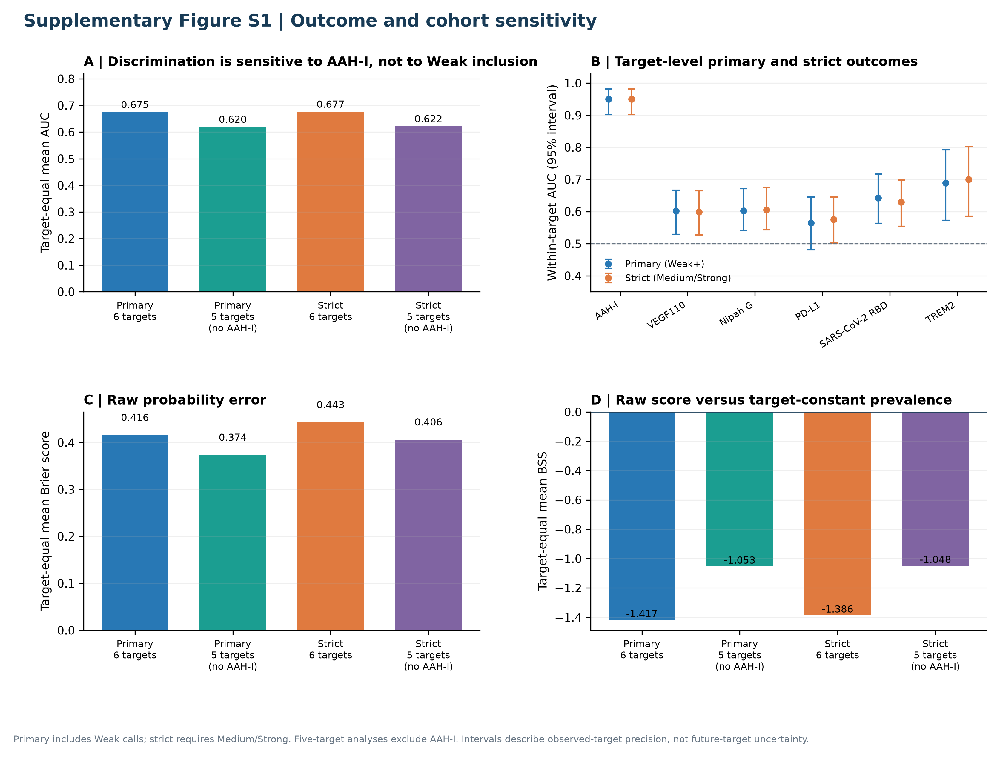

Target-equal AUC, Brier score, and Brier skill score under primary and strict outcomes, with and without AAH-I. Target-level intervals are 95% within-target sequence-cluster bootstrap intervals. Lower Brier is better; BSS=0 equals the target-constant prevalence reference. These sensitivity analyses do not create a new primary cohort.

*Numerical or accepted panel source:* `analysis/rq12_outputs/rq12_target_metrics.csv`; `analysis/rq12_outputs/rq12_summary_metrics.csv`.

### Supplementary Figure S2. Linear versus restricted-cubic-spline zero-label transport

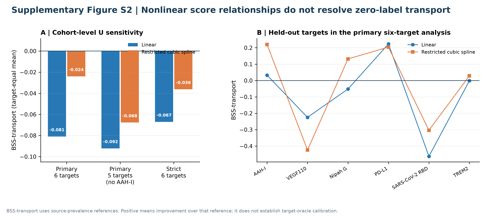

The sole prespecified nonlinear sensitivity analysis uses a three-knot restricted cubic spline on clipped logit-ipTM, with knots learned only from source training data. Primary six-target BSS-transport improves from −0.0809 to −0.0240 but remains negative. No further model search was triggered.

*Numerical or accepted panel source:* `analysis/codex_outputs/RQ3_F_correction_2026-11-13/run_20261113_182311/rq3_loto_macro_summary.csv`; `analysis/codex_outputs/RQ3_F_correction_2026-11-13/run_20261113_182311/rq3_loto_metrics.csv`.

### Supplementary Figure S3. Post hoc external U/I/F out-of-fold metrics

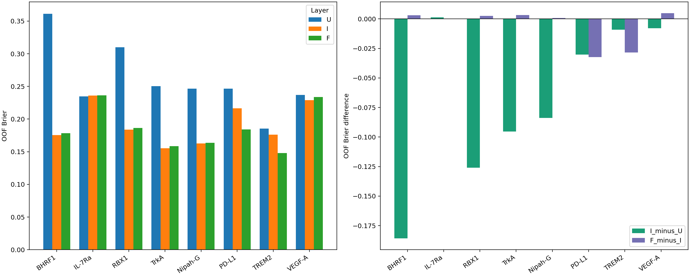

External local intercept and intercept-plus-slope adaptation, evaluated out of fold on identical rows as U. Intercept adaptation reduces Brier in seven of eight targets; F improves on I only in PD-L1 and TREM2. This analysis was added after external U was examined and is exploratory.

*Numerical or accepted panel source:* `analysis/rq3e_if_outputs/run_20261114_174403/RQ3E_IF_OOF_metrics.png`.

### Supplementary Figure S4. Post hoc external U/I/F reliability

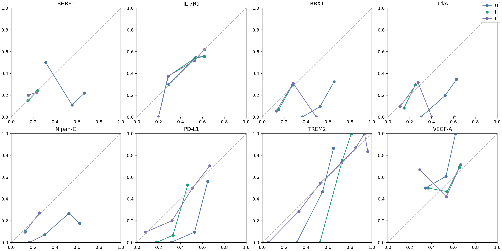

Out-of-fold reliability for external U, I, and F. Local labels are used during adaptation; the display does not alter or rescue the confirmatory zero-label U result.

*Numerical or accepted panel source:* `analysis/rq3e_if_outputs/run_20261114_174403/RQ3E_IF_OOF_reliability.png`.

### Supplementary Figure S5. Nonconfirmatory low-event stress test

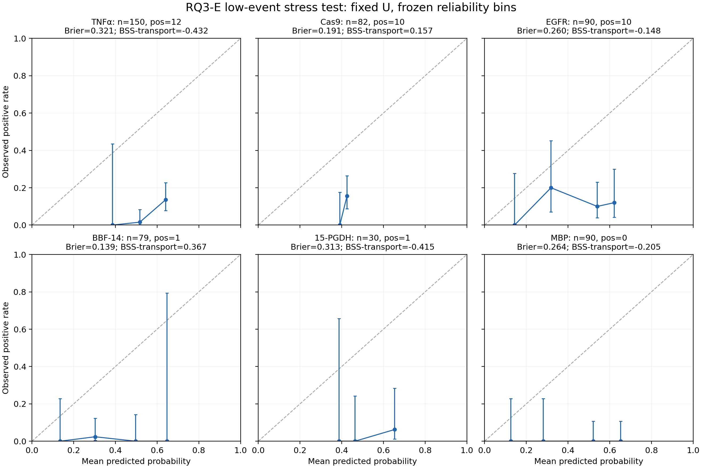

Six low-event targets (521 pairs) evaluated with the unchanged frozen U mapping. Mean predictions exceed observed prevalence in all six. MBP has zero positives; BBF-14 and 15-PGDH each have one, limiting or precluding slope and target-oracle interpretation.

*Numerical or accepted panel source:* `analysis/rq3e_outputs/run_20261114_162656/RQ3E_U_low_event_stress_test.png`.

### Supplementary Figure S6. External outcome, score-rule, and source-weight sensitivity

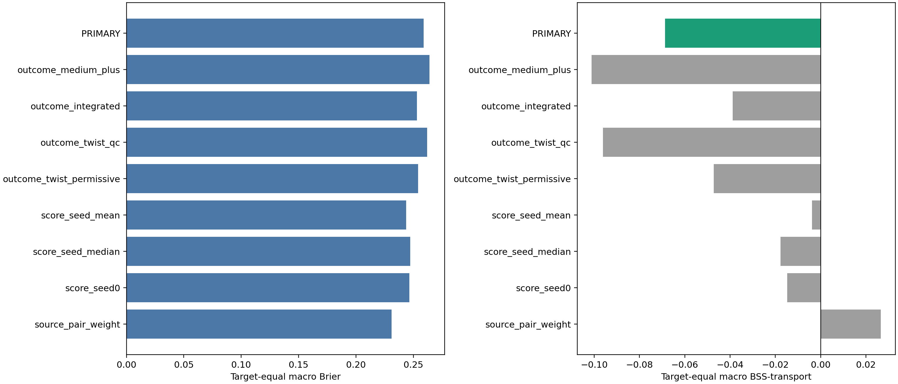

Prespecified external sensitivity analyses across outcome definitions, score summaries/seeds, and source weighting. Changes in Brier or BSS-transport do not establish a stable probability mapping; BSS-target-oracle remains a diagnostic reference.

*Numerical or accepted panel source:* `analysis/rq3e_outputs/run_20261114_164950/RQ3E_U_external_sensitivity.png`.

### Supplementary Figure S7. Shared-budget pilot sensitivity across analysis sets

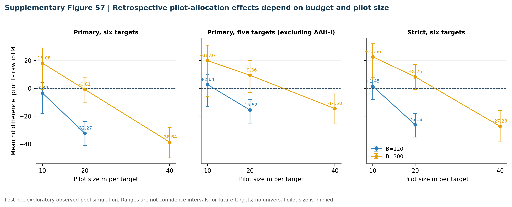

Paired retrospective differences between pilot-I and raw-ipTM allocation. Error bars are central 95% simulation ranges. Pilot assays count against B and pilot-identified hits count toward total hits. Primary six-target scenarios use 2,000 replicates; five-target and strict scenarios use 1,000.

*Numerical or accepted panel source:* `analysis/rq4_outputs/run_20261114_231925/rq4c_comparisons.csv`.

### Supplementary Figure S8. Raw Pinc and ipTM reliability on common complete cases

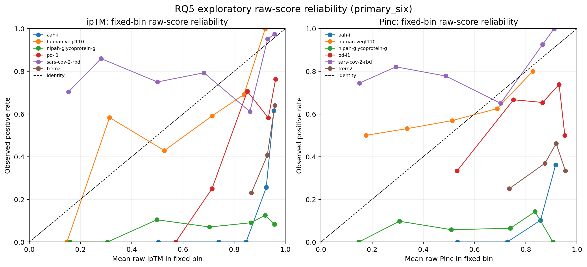

Raw-score reliability for Pinc and ipTM on the same 2,074 complete-case pairs and 740 primary positives. Both scores have negative target-constant BSS in every target; lower raw error is not achieved calibration.

*Numerical or accepted panel source:* `analysis/codex_outputs/RQ5_execution_2026-11-15/run_20261115_111720/RQ5_raw_reliability.png`.

### Supplementary Figure S9. Pinc increment across analysis sets and source weighting

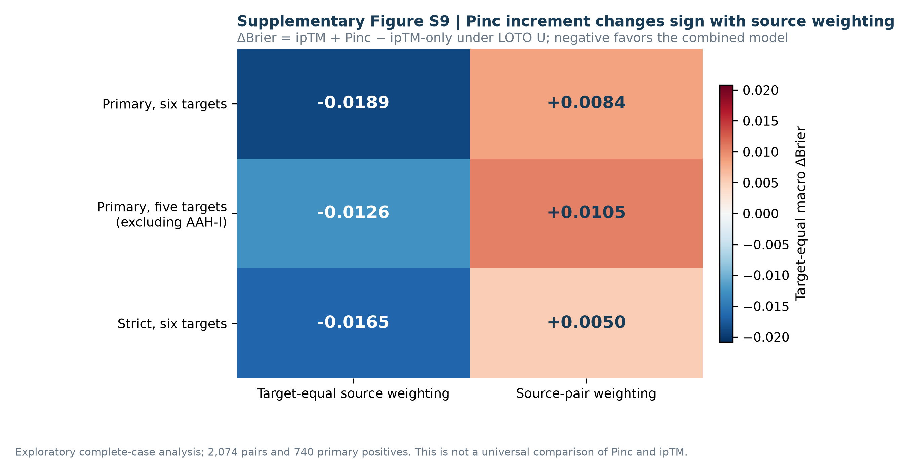

Complete-case LOTO U comparison of ipTM+Pinc versus ipTM-only on identical rows and folds. The summary_type filter is target_equal_macro; source_weighting varies independently between target_equal and pair. Negative ΔBrier favors the combined model. The sign reversal under source-pair weighting precludes a stable general increment claim.

*Numerical or accepted panel source:* `analysis/codex_outputs/RQ5_execution_2026-11-15/run_20261115_111720/rq5_sensitivity_summary.csv`.

### Supplementary Figure S10. Target-equal description across ten predictor pipelines

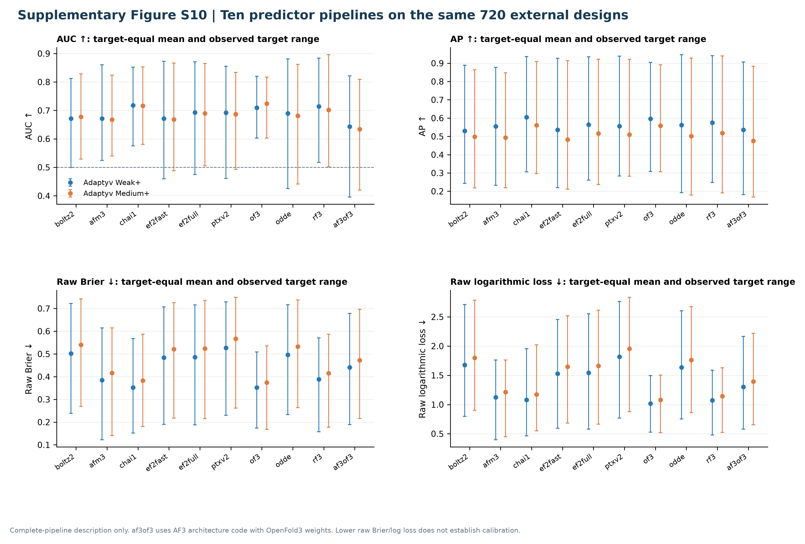

Points are target-equal means across eight targets; lines extend from the minimum to maximum target-specific value and are not confidence intervals. Ten complete pipelines are compared on the same 720 external designs under two outcomes. No U/I/F mapping is fitted across predictors and no superiority test is performed.

*Numerical or accepted panel source:* `analysis/codex_outputs/RQ6_execution_2026-11-15/run_20261115_151147/rq6_target_equal_summary.csv`.

### Supplementary Figure S11. Post hoc ipSAE and paired bootstrap sensitivity

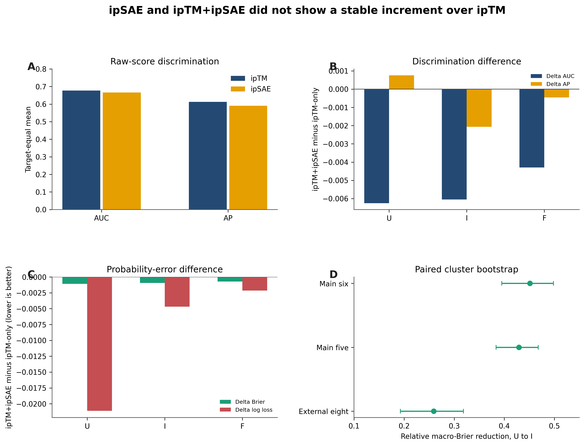

ipSAE alone and ipTM-plus-ipSAE did not show a stable increment over ipTM. (A) Raw target-equal AUC and AP for ipTM and ipSAE. (B) ipTM-plus-ipSAE minus ipTM-only differences in AUC and AP across U, I, and F. (C) Differences in Brier score and log loss across the same layers. (D) Relative macro-Brier reduction from U to I with 95% paired sequence-cluster bootstrap intervals for the primary-six, primary-five, and external analyses. Negative Brier/log-loss differences favor the combination in B/C. The feature-combination analysis was added after the single-score results and is post hoc sensitivity evidence.

*Numerical sources:* `analysis/postreview_revision_2026-11-21/ipSAE/ipSAE_macro_metrics.csv`; `analysis/postreview_revision_2026-11-21/ipSAE/ipSAE_paired_comparisons.csv`; `analysis/postreview_revision_2026-11-21/ipSAE_combo/combo_paired_comparisons.csv`; `analysis/postreview_revision_2026-11-21/bootstrap/bootstrap_macro_intervals.csv`.

## Reproducibility and release boundaries

1. The numerical sources are accepted frozen outputs. Workbook construction did not rerun the scientific analyses, refit mappings, or choose configurations after inspecting performance.
2. Main-cohort and external transport conditions differ in score-generation protocol as well as target/campaign. External U therefore evaluates the released score plus frozen mapping, not an isolated target effect under an identical protocol.
3. The external confirmatory cohort covers primary prevalences of 21.1%–72.2%. The 521-pair low-event stress test is nonconfirmatory; the main cohort’s 84.3% high-prevalence extreme remains uncovered externally.
4. The accessible Overath mirror has 3,669 records versus 3,766 reported in the article. Exact and near-sequence audits do not establish temporal, training-data, structural, or epitope independence.
5. External I/F and shared-budget analyses are post hoc exploratory. They do not establish zero-label success, prospective assay savings, or a universal pilot size.
6. Portable source paths and hashes make this release package auditable. Proteinbase is pinned to version `v2026-11-01` and revision `2d2825070da5ba77e0c7e1a0942146e8307e9282` under ODC-BY. The Claude protein binder design data release is pinned to v1.0 and revision `9e1b81696da46835e9e9cde9a3da976e0abc92ab`; its data and documentation use CC BY 4.0, included scripts use MIT, and third-party material retains its own terms. The public repository is https://github.com/kami518/boltz2-iptm-binder-calibration and the reserved archival DOI is `10.5281/zenodo.24400262`. Author metadata are complete; Zenodo publication and DOI activation remain pending mainline release approval.
